<div align="center">


# DnD-Tabletop

**Der virtuelle Spieltisch, der auf deinem Rechner läuft.**
Du startest ihn, deine Spieler öffnen eine Webseite, fertig: im selben WLAN oder von zu Hause über Tailscale.
Keine Cloud, kein Abo, keine Accounts. Alle Daten bleiben bei dir.

[](https://github.com/Mr3Sepz/dnd_tabletop/actions/workflows/ci.yml)
[](https://github.com/Mr3Sepz/dnd_tabletop/actions/workflows/release.yml)
  


</div>

---

## Inhalt

- [Loslegen](#loslegen)
- [Die DM-Ansicht im Überblick](#die-dm-ansicht-im-überblick)
- [Vor der Sitzung](#vor-der-sitzung): [Einladen](#1-spieler-einladen) · [Szenen und Karten](#2-szenen-und-karten) · [Figuren und NPCs](#3-figuren-und-npcs) · [Objekte und Zeichnungen](#4-objekte-zeichnungen-und-schablonen)
- [Während des Spiels](#während-des-spiels): [Figurenmenü](#5-das-figurenmenü) · [Mehrere Figuren](#6-mehrere-figuren-auf-einmal) · [Initiative](#7-porträtleiste-und-initiative) · [Schaden und Zustände](#8-schaden-zustände-und-0-hp) · [Fog of War](#9-fog-of-war) · [Getrennte Gruppen](#10-getrennte-gruppen) · [Sicht pro Spieler](#11-sicht-pro-spieler) · [Messen](#12-entfernungen-messen) · [Würfel](#13-würfeln) · [Vorschau](#14-als-spieler-ansehen)
- [Notizen, Speichern, Beenden](#notizen-speichern-beenden)
- [Was deine Spieler sehen](#was-deine-spieler-sehen)
- [Spickzettel](#spickzettel)
- [Einstellungen](#einstellungen) · [Probleme lösen](#probleme-lösen) · [Für Entwickler](#für-entwickler)

---

## Loslegen

### 1. Herunterladen

| System | Datei | Starten |
| --- | --- | --- |
| **Linux** | `DnD-Tabletop-…-x86_64.AppImage` | Rechtsklick → *Eigenschaften* → *Als Programm ausführen* erlauben, dann doppelklicken |
| **Windows** | `DnD-Tabletop-…-windows-x64.zip` | Entpacken, im Ordner **`start.bat`** doppelklicken |

Beide Dateien findest du unter **[Releases](https://github.com/Mr3Sepz/dnd_tabletop/releases)**. Node.js ist schon enthalten, du musst nichts installieren.
Den jeweils neuesten Entwicklungsstand gibt es außerdem bei jedem Lauf von [„Pakete bauen“](https://github.com/Mr3Sepz/dnd_tabletop/actions/workflows/release.yml) unter *Artifacts* (Anmeldung bei GitHub nötig).

<details>
<summary>Aus dem Quellcode starten (für Bastler)</summary>

Du brauchst [Node.js](https://nodejs.org) 18 oder neuer.

```bash
git clone https://github.com/Mr3Sepz/dnd_tabletop.git
cd dnd_tabletop
./start.sh          # Linux/macOS, unter Windows: start.bat
```
</details>

### 2. Starten

Nach dem Start öffnet sich die **DM-Ansicht** im Browser. Das Fenster mit den Adressen (Terminal) bleibt offen, solange gespielt wird.

> **Windows:** Beim ersten Start fragt die Firewall, ob Node.js ins Netzwerk darf. Erlaube das für **private Netzwerke**, sonst kommen die Spieler nicht rein.

### 3. Spieler einladen

Im Reiter **Spiel** steht ein QR-Code. Die Spieler scannen ihn mit dem Handy, wählen einen Platz und geben ihren Namen ein. Wie das genau geht, steht unter [Spieler einladen](#1-spieler-einladen).

---

## Die DM-Ansicht im Überblick


| Bereich | Was dort passiert |
| --- | --- |
| **Kopfzeile** | Welche Szene die Spieler sehen · welche Szene du gerade bearbeitest · **Live schalten** · **Spielersicht**-Vorschau · Zoom · grüner Punkt = verbunden |
| **Porträtleiste** (oben) | Alle Kampfteilnehmer in Initiative-Reihenfolge. Wer dran ist, hat einen roten Rahmen. Die Spieler sehen die Leiste auch |
| **Werkzeugleiste** (links auf der Karte) | 🖐 Auswählen · 📏 Messen · ▭ ◯ ✎ Zeichnen · 🧱 Objekt · 🔥 Zauberschablone · ☀ ☁ Nebel aufdecken/verdecken |
| **Karte** (Mitte) | Mausrad oder zwei Finger = Zoom, Fläche ziehen = verschieben, **Rechtsklick** oder **lange drücken** auf eine Figur = Menü |
| **Seitenleiste** (rechts) | Reiter *Szenen · Figuren · Spieler · NPCs · Notizen · Spiel* |
| **🎲** (unten links) | Würfel mit Protokoll |

Auf dem Tablet oder Handy klappt die Seitenleiste mit **☰** auf und zu.

---

## Vor der Sitzung

### 1. Spieler einladen

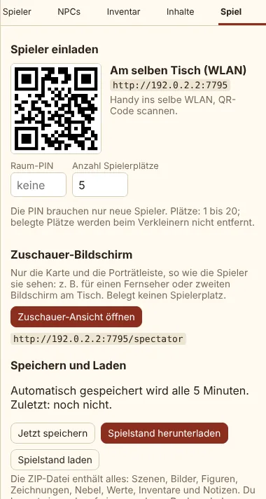

Reiter **Spiel**:

- **QR-Code und Adresse** für alle im selben WLAN. Spielt jemand über Tailscale, erscheint zusätzlich eine zweite Adresse, die mit `100.` beginnt.
- **Raum-PIN:** Ist sie gesetzt, kommen nur Spieler rein, die sie kennen. Wer schon drin ist, bleibt drin.
- **Anzahl Spielerplätze:** Standard ist 5, möglich sind 1 bis 20. Belegte Plätze werden beim Verkleinern nie entfernt.

Fliegt jemand kurz aus dem WLAN, landet er automatisch wieder auf seinem Platz. Einen Platz freigeben kannst du im Reiter **Spieler**.

<details>
<summary>Spieler von zu Hause (Tailscale) einrichten</summary>

1. Du und jeder Mitspieler von außerhalb installiert [Tailscale](https://tailscale.com/download) (kostenlos) und meldet sich an.
2. Du lädst die Mitspieler in dein Tailscale-Netz ein (Tailscale-Adminseite → *Users* → *Invite*) oder teilst deinen Rechner mit ihnen (*Share*).
3. Die App zeigt im Reiter **Spiel** automatisch die Tailscale-Adresse (`http://100.…`) mit eigenem QR-Code.
</details>

<br clear="right">

### 2. Szenen und Karten


Eine **Szene** ist ein Ort mit eigener Karte, eigenen Figuren, Zeichnungen und eigenem Nebel, zum Beispiel *Waldweg* oder *Cragmaw-Höhle*.

- **+ Neue Szene**, dann **Bild hochladen**. Große Bilder werden automatisch verkleinert, damit sie bei allen schnell laden.
- **Raster:** Es ist sofort da. Stell die **Feldgröße** so ein, dass ein Feld einem Kästchen deiner Karte entspricht, oder ändere stattdessen die **Kartengröße**. *Fuß pro Feld* (Standard 5) braucht das Lineal.
- **Figuren rasten im Feld ein:** Figuren springen beim Loslassen in die Feldmitte. Pro Szene abschaltbar.
- **Nachtfilter:** Macht aus einer Tagkarte eine Nachtszene.
- **Notiz zur Szene:** Raumbeschreibung, Fallen, Schätze. Nur du siehst sie.

**Im Hintergrund vorbereiten:** Oben bei *Bearbeite* wählst du eine andere Szene aus. Die Spieler sehen weiter die alte, bis du **Live schalten** drückst.

<br clear="right">

### 3. Figuren und NPCs

**Bildersammlung** (Reiter *Figuren*): Lade Porträts, Monster und Objekte über **+ Bilder** hoch oder ziehe sie direkt ins Fenster. Danach ziehst du ein Bild auf die Karte oder tippst es an und dann auf die Karte.

**Spielercharaktere** (Reiter *Spieler*): Gruppenkarte anklicken, Name, Porträt und HP eintragen, dann **Figur setzen**. Diese Figur darf nur der zugehörige Spieler bewegen. Du darfst immer alles.

**NPCs** (Reiter *NPCs*): **+ Neuer NPC**, Porträt und Werte eintragen, dann **Auf Karte setzen …**

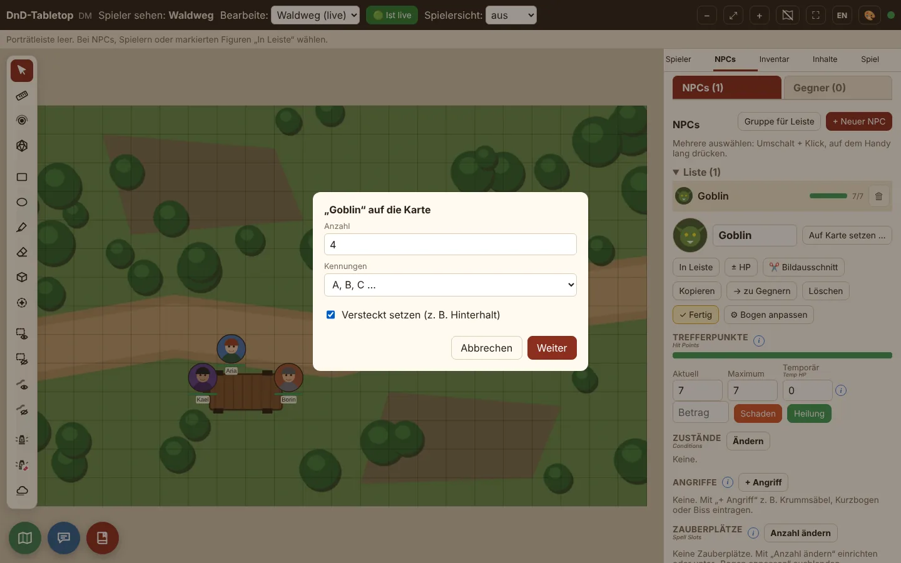

Beim Setzen eines NPCs wählst du:
- **Anzahl:** 4 Goblins auf einmal. Jeder bekommt eigene HP.
- **Kennungen:** 1, 2, 3 … oder A, B, C … vorgeschlagen und frei änderbar. Sie stehen als Abzeichen auf der Figur.
- **Versteckt setzen:** für einen Hinterhalt. Nur du siehst die Figuren, halb durchsichtig.

### 4. Objekte, Zeichnungen und Schablonen

| Werkzeug | Wofür |
| --- | --- |
| ▭ ◯ ✎ | Rechteck, Ellipse, Freihand, z. B. für Deckung, Gelände oder einen brennenden Busch. Farbe, Füllung und Strichstärke stellst du in der Leiste ein |
| 🧱 **Objekt** | Ein Bild aus der Sammlung als **eckiges, drehbares** Objekt: Wagen, Tür, Tisch |
| 🔥 **Schablone** | Kreis, Kegel, Linie oder Würfel in Fuß, z. B. „Feuerball, 20 ft“ |

Ein Klick mit 🖐 auf eine Zeichnung zeigt Griffe zum **Verschieben, Drehen und Skalieren**. Per Rechtsklick kannst du sie **verstecken** (z. B. eine Falltür, die erst später auftaucht), **sperren**, nach vorne oder hinten legen, beschriften oder löschen.

---

## Während des Spiels

### 5. Das Figurenmenü


**Rechtsklick** oder **lange drücken** auf eine Figur. Das Menü gibt es mit Absicht nur so, damit nichts aus Versehen passiert.

| Eintrag | Was passiert |
| --- | --- |
| Schaden / Heilung … | Betrag eingeben → *Schaden*, *Heilung* oder *Temporäre HP*. Schaden zieht zuerst temporäre HP ab |
| Zustände … | Liegend, vergiftet, gepackt, bewusstlos, Segen, Konzentration … oder ein eigener Zustand |
| Verstecken / Aufdecken | Versteckte Figuren kommen bei den Spielern gar nicht erst an |
| Sichtbar für … | Nur bestimmte Spieler sehen die Figur ([mehr dazu](#11-sicht-pro-spieler)) |
| Bearbeiten … | Name, Kennung, Bild, Größe, verknüpfter Charakter/NPC, wer sie bewegen darf, Farbe |
| Werte öffnen | Öffnet den Bogen rechts. Das geht auch per normalem Klick auf die Figur |
| In Porträtleiste · Größer · Kleiner · Kopieren · Nach vorne · Löschen | |

### 6. Mehrere Figuren auf einmal

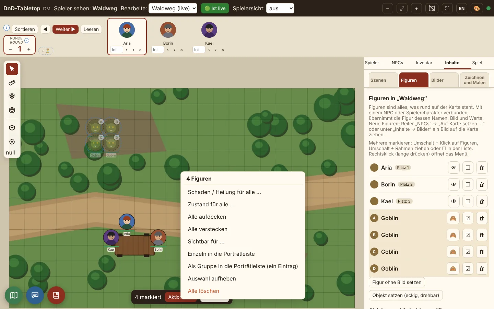

**Markieren:** Umschalt + Klick auf Figuren, **Umschalt + Rahmen ziehen** auf freier Fläche oder ☐ in der Figurenliste. Unten erscheint *„4 markiert · Aktionen …“*:

- **Schaden / Heilung für alle:** Feuerball, Wasserflut, Falle.
- **Zustand für alle**, **alle aufdecken / verstecken**, **Sichtbar für …**
- **Als Gruppe in die Porträtleiste:** ein Eintrag „Goblins ×4“ statt vier einzelner.
- Markierte Figuren **ziehst du gemeinsam**.

### 7. Porträtleiste und Initiative

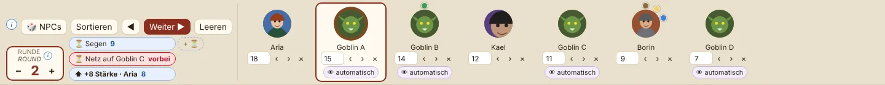

- **In die Leiste:** im Bogen „In Leiste“, im Figurenmenü „In Porträtleiste“ oder im Reiter *Spieler* „Alle in Leiste“ (nimmt nur Charaktere, die mitspielen).
- **Initiativwert** ins kleine Feld unter dem Porträt tippen, dann **Sortieren**. Der Höchste beginnt.
- **Reihenfolge ändern:** Porträt ziehen (Maus) oder **‹ ›** (Touch). **Weiter ▶** schaltet zum Nächsten. Ein Klick auf ein Porträt macht es zum aktuellen.
- **👁 Sichtbarkeit** pro NPC-Eintrag:
  - *automatisch:* erscheint bei den Spielern erst, wenn eine Figur davon für sie sichtbar ist. **Ein versteckter Hinterhalt verrät sich also nicht durch die Leiste.**
  - *immer* / *nie* (🚫).
  - Einträge, die gerade kein Spieler sieht, haben bei dir einen gestrichelten Rahmen.
- Bei Gegnern sehen die Spieler **nie die HP**, nur einen farbigen Ring: unverletzt · angeschlagen · schwer verletzt · am Boden · tot.

### 8. Schaden, Zustände und 0 HP

<table>
<tr>
<td width="50%">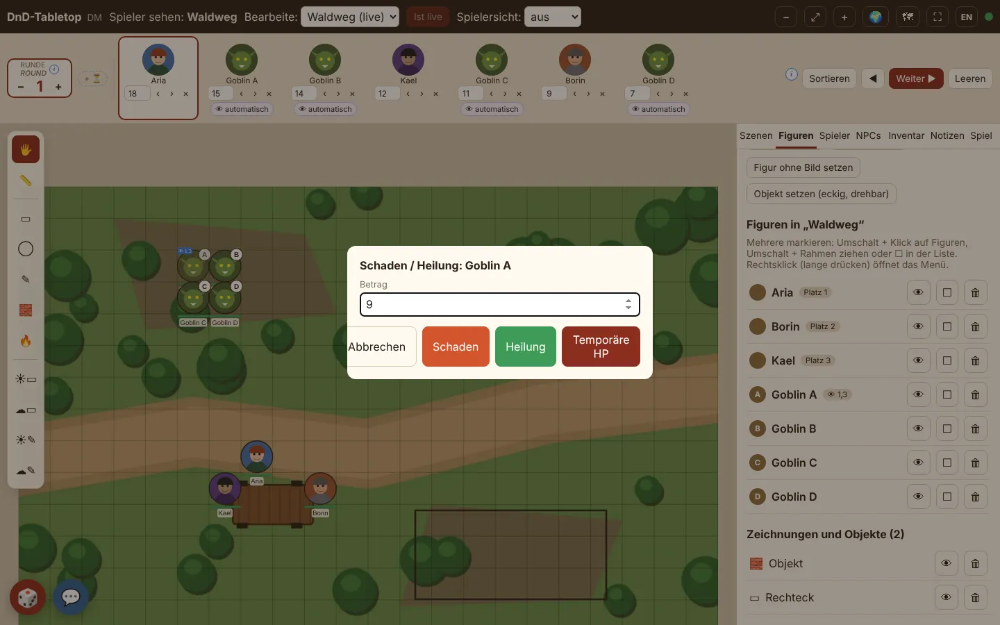</td>
<td width="50%"></td>
</tr>
<tr>
<td><b>Schaden / Heilung</b>: über das Figurenmenü, den Knopf „± HP“ im Bogen oder für mehrere markierte Figuren.</td>
<td><b>Zustände</b>: farbige Ringe um Figur und Porträt, für alle sichtbar. Spieler dürfen Zustände ihres eigenen Charakters selbst setzen.</td>
</tr>
</table>


**Fällt ein NPC auf 0 HP**, fragt die App: **tot oder am Boden?** Der niedergeschlagene Goblin für das Verhör bleibt so „am Boden“ (grau). Erst „tot“ bekommt ein Kreuz. Wird er geheilt, steht er wieder.

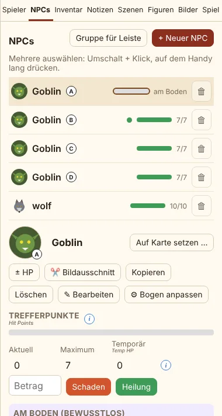

Bei 0 HP zeigt der Bogen **Todesrettungswürfe** (3 Erfolge, 3 Fehlschläge). Das gilt für Spieler wie für NPCs.

Der **Bogen** (Spieler wie NPC) enthält außerdem:
- **HP:** aktuell, maximal, temporär; Schaden- und Heilen-Knöpfe.
- **Werte** wie die RK, frei benennbar.
- **Zauberplätze:** „Anzahl ändern“ legt pro Grad fest, wie viele es gibt. Kästchen abhaken = verbraucht. „Alle frei“ setzt zurück.
- **Zähler:** Ki, Kampfrausch, Heiltränke …
- **Inventar** (Spieler) bzw. **Notiz** (NPC).

<br clear="right">

### 9. Fog of War

<table>
<tr>
<td width="55%">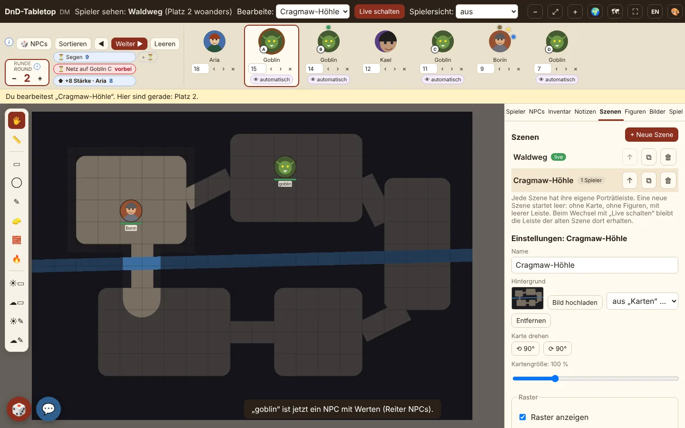</td>
<td width="45%">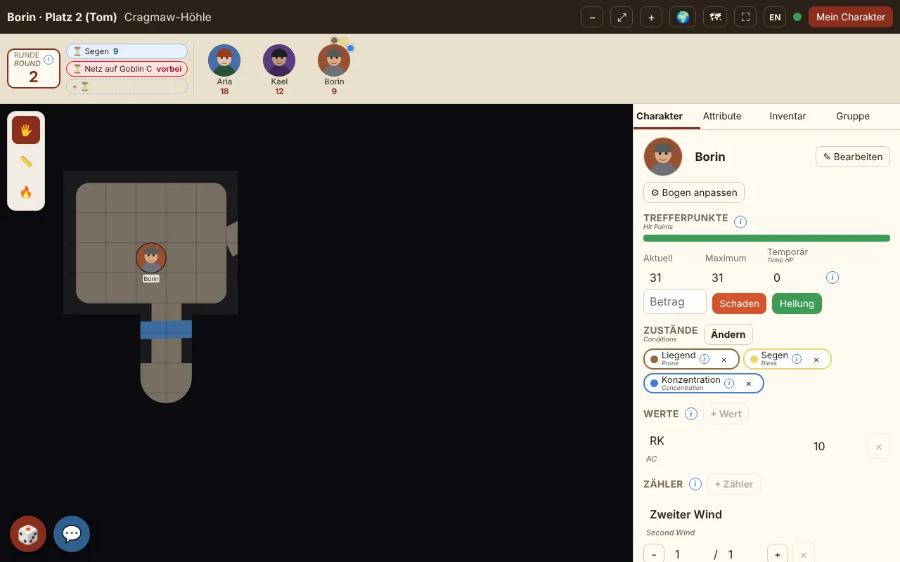</td>
</tr>
<tr>
<td><b>Du</b> siehst den Nebel halb durchsichtig. Aufgedecktes ist hell.</td>
<td><b>Der Spieler</b> sieht nur den aufgedeckten Teil. Der Goblin im Nebel kommt bei ihm gar nicht erst an.</td>
</tr>
</table>

1. Reiter **Szenen** → **Fog of War** → *Alles verdecken*.
2. Werkzeuge links: **☀▭** Rechteck aufdecken, **☀✎** mit dem Pinsel aufdecken (Größe einstellbar), **☁▭ / ☁✎** wieder verdecken.
3. *Rückgängig* nimmt den letzten Schritt zurück. *Alles aufdecken* deckt mit einem Klick alles auf.

Eigene Figuren sieht jeder Spieler immer, auch im Nebel.

### 10. Getrennte Gruppen

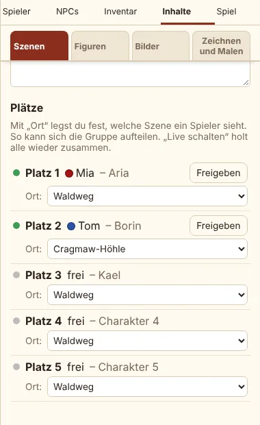

Die Gruppe teilt sich auf? Im Reiter **Spieler** wählst du bei jedem Platz den **Ort**, also die Szene, die dieser Spieler sieht. Tom klettert allein in die Höhle, Mia bleibt am Waldweg.

- Die Kopfzeile zeigt dann *„Spieler sehen: Waldweg (Platz 2 woanders)“*.
- In der Szenenliste steht, wie viele Spieler gerade wo sind.
- **Live schalten** bzw. **Alle hierher** holt wieder alle in eine Szene.

<br clear="right">

### 11. Sicht pro Spieler

Nach einem Wahrnehmungswurf hat nur Mia den Goblin im Gebüsch bemerkt? Figurenmenü → **Sichtbar für …** → Platz 1 anhaken. Nur Mia sieht ihn, die anderen nicht. Bei dir trägt die Figur ein kleines blaues 👁 mit den Platznummern. Kein Haken = wieder für alle sichtbar.

### 12. Entfernungen messen

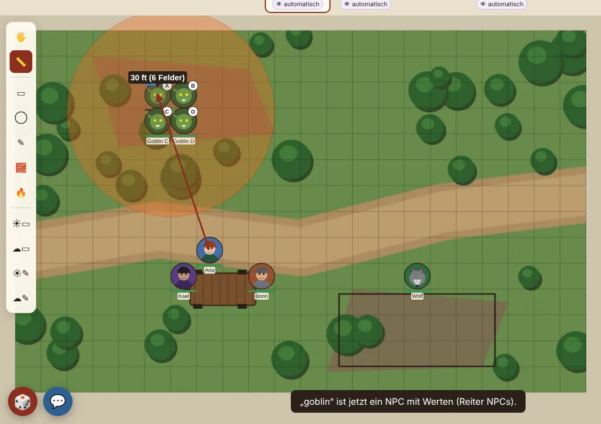

📏 auswählen und ziehen: Die App zeigt **Fuß und Felder** (5e-Regel: Diagonalen zählen wie gerade Felder). Beim **Ziehen einer Figur** siehst du die Strecke automatisch. Spieler haben das Lineal auch.

### 13. Würfeln

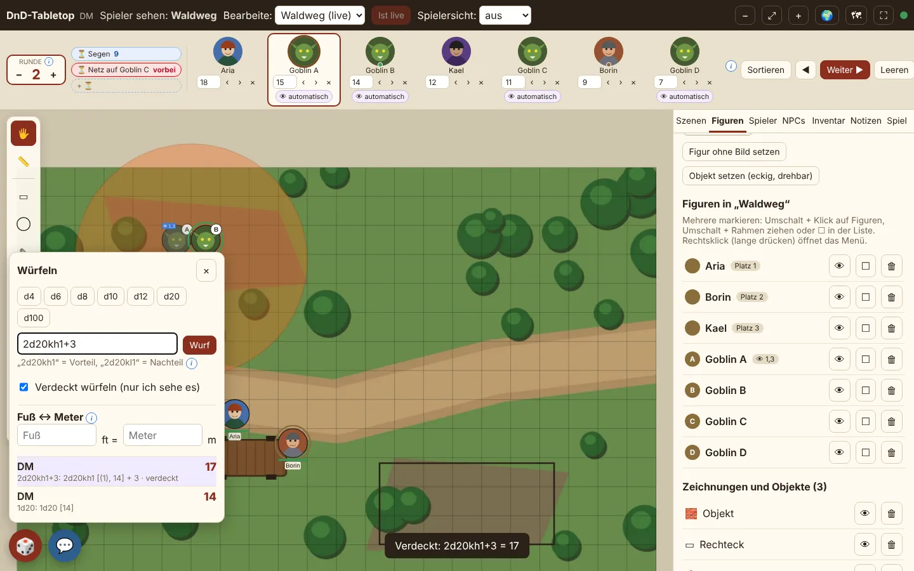

**🎲** unten links: Schnellknöpfe d4 bis d100 oder freie Eingabe wie `1d20+5`, `2d20kh1` (Vorteil), `2d20kl1` (Nachteil), `4d6kh3`. Jeder Wurf wird kurz bei allen eingeblendet und landet im Protokoll.

**Verdeckt würfeln** (Haken): Das Ergebnis siehst nur du. Echte Würfel am Tisch bleiben natürlich gleichwertig.

### 14. Als Spieler ansehen


Oben bei **Spielersicht** einen Platz wählen: Du siehst **genau** das, was dieser Spieler sieht, mit Nebel, ohne Verstecktes und mit seiner Porträtleiste. Zum Beispiel, um zu prüfen, ob der Hinterhalt wirklich verborgen ist. „aus“ bringt dich zurück.

---

## Notizen, Speichern, Beenden

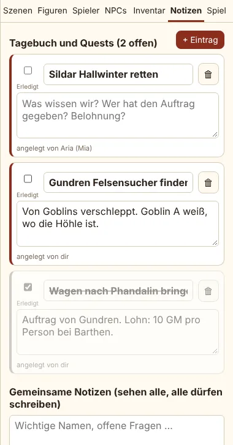

**Reiter Notizen**
- **Gruppe (sehen alle):** XP, Gold/Beute, Spieldatum/Uhrzeit. Dazu gemeinsame Notizen, die alle Spieler mitschreiben dürfen.
- **Mein Notizblock:** nur für dich.
- Private Notizbücher der Spieler siehst du nicht. Die gehören den Spielern.

**Speichern** (Reiter *Spiel*)
- **Automatisch** alle 5 Minuten und beim Beenden. Beim nächsten Start geht es genau dort weiter.
- **Spielstand herunterladen:** eine ZIP-Datei mit *allem* (Szenen, Bilder, Figuren, Nebel, Zeichnungen, Werte, Notizen). Du kannst so oft speichern, wie du willst.
- **Spielstand laden:** stellt den Stand exakt wieder her, auch auf einem anderen Rechner.

**Beenden:** *Spiel → Server beenden* speichert und trennt alle. Alternativ Strg+C im Terminal. Ein zweiter Doppelklick auf die App öffnet die laufende Runde, statt eine neue zu starten.

<br clear="right">

---

## Was deine Spieler sehen

<table>
<tr>
<td width="30%">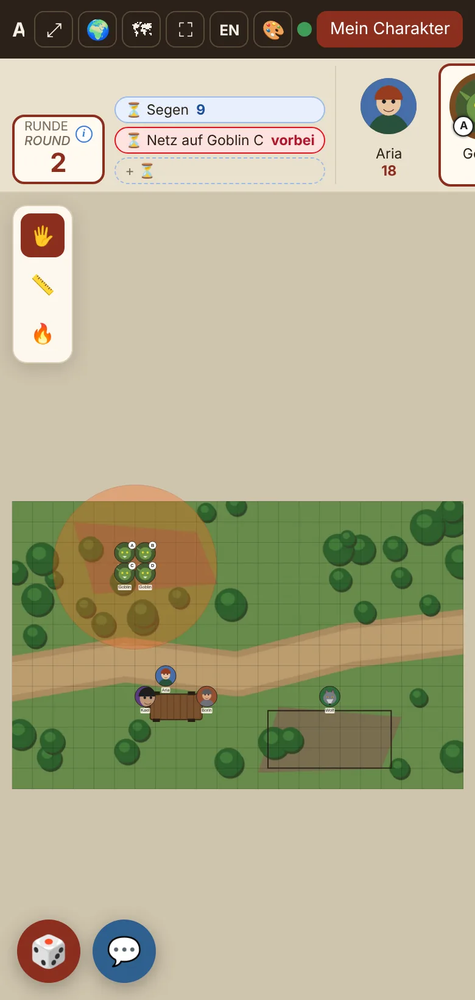</td>
<td width="70%"></td>
</tr>
</table>

- **Ihre Szene**, ohne Verstecktes, mit Nebel. Gegner nur mit grobem Zustand.
- **Ihre eigenen Figuren** bewegen sie selbst. Andere Figuren können sie nicht bewegen.
- **Mein Charakter:** HP, Werte, Zauberplätze, Zähler, Zustände, Inventar und ein **privates Notizbuch**, das auch du nicht siehst.
- **Gruppe:** XP, Gold, Spieldatum, gemeinsame Notizen.
- **Werkzeuge:** 📏 Messen, 🔥 eigene Zauberschablonen legen und drehen, 🎲 Würfeln.

---

## Spickzettel

| Ich will … | So geht's |
| --- | --- |
| Karte zoomen / verschieben | Mausrad oder zwei Finger / freie Fläche ziehen · ⤢ = ganze Karte |
| Menü einer Figur | Rechtsklick oder lange drücken |
| Mehrere Figuren markieren | Umschalt + Klick · Umschalt + Rahmen ziehen · ☐ in der Liste |
| Auswahl / Werkzeug abbrechen | `Esc` |
| Hinterhalt vorbereiten | NPC → *Auf Karte setzen …* → Anzahl + „versteckt“ |
| Goblins auftauchen lassen | markieren → *Aktionen* → *Alle aufdecken* |
| Feuerball auf mehrere | markieren → *Schaden / Heilung für alle* |
| Kampf starten | *Alle in Leiste* · Goblins als Gruppe · Werte eintippen · *Sortieren* · *Weiter ▶* |
| Höhle erkunden | Szene → *Alles verdecken* → ☀▭ / ☀✎ Stück für Stück aufdecken |
| Gruppe teilt sich | Reiter *Spieler* → *Ort* pro Platz |
| Nur einer bemerkt etwas | Figurenmenü → *Sichtbar für …* |
| Geheim würfeln | 🎲 → *Verdeckt würfeln* |
| Szene vorbereiten, ohne dass es jemand sieht | oben *Bearbeite:* andere Szene → später *Live schalten* |

---

## Einstellungen

Normalerweise musst du nichts einstellen. Wenn doch: Lege eine Datei **`config.json`** an (Vorlage: `config.example.json`). Sie gehört in den Programmordner, beim AppImage nach `~/.config/dnd-tabletop/config.json`.

| Schlüssel | Bedeutung | Standard |
| --- | --- | --- |
| `port` | Port des Servers | `7777` |
| `dmPassword` | Passwort für die DM-Ansicht. **Leer = DM-Ansicht nur am Host-Rechner.** Mit Passwort geht sie auch vom Tablet aus | leer |
| `pin` | Start-PIN für Spieler (im Spiel änderbar) | leer |
| `seats` | Spielerplätze für neue Spielstände (im Spiel änderbar, 1–20) | `5` |
| `autosaveMinutes` | Autosave-Intervall | `5` |
| `dataDir` | Ordner für Spielstand und Bilder | `data` bzw. `~/.local/share/dnd-tabletop` |
| `openBrowser` | DM-Ansicht beim Start öffnen | `true` |

Umgebungsvariablen gehen auch: `PORT`, `DND_DM_PASSWORD`, `DND_PIN`, `DND_SEATS`, `DND_DATA_DIR`, `DND_NO_BROWSER=1`.

---

## Probleme lösen

<details>
<summary><b>Spieler kommen nicht rein</b></summary>

- Ist das Handy im **selben WLAN** (nicht im Gäste-WLAN)?
- Windows: Hat die Firewall Node.js für **private Netzwerke** erlaubt? Sonst: *Windows-Sicherheit → Firewall → App durch die Firewall zulassen → Node.js*.
- Stimmt die **PIN**? Im Reiter *Spiel* kannst du sie ändern oder leeren.
</details>

<details>
<summary><b>„Platz ist schon belegt“</b></summary>

Reiter *Spieler* → bei dem Platz **Freigeben**. Danach kann sich der Spieler neu anmelden.
</details>

<details>
<summary><b>AppImage startet nicht (Linux)</b></summary>

- Ausführbar machen: `chmod +x DnD-Tabletop-*.AppImage`
- Fehlt **FUSE**, hilft unter Ubuntu `sudo apt install libfuse2` oder der Start mit `./DnD-Tabletop-*.AppImage --appimage-extract-and-run`.
</details>

<details>
<summary><b>„Port ist von einem anderen Programm belegt“</b></summary>

In der `config.json` einen anderen `port` eintragen, z. B. `7778`.
</details>

<details>
<summary><b>DM-Ansicht vom Tablet aus nutzen</b></summary>

In der `config.json` ein `dmPassword` setzen. Ohne Passwort ist die DM-Ansicht aus Sicherheitsgründen nur am Rechner erreichbar, auf dem die App läuft.
</details>

---

## Für Entwickler

```bash
npm install
npm run dev                       # Server mit automatischem Neustart
npm test                          # Server-Tests (Linux und Windows in GitHub Actions)
python3 test/browser_tour.py      # Browser-Rundgang, erzeugt die Bilder in docs/img
bash scripts/build-appimage.sh    # Linux-AppImage
bash scripts/build-windows.sh     # portable Windows-ZIP
```

- [docs/ARCHITEKTUR.md](docs/ARCHITEKTUR.md): wie es funktioniert und wo was liegt
- [docs/FEATURES.md](docs/FEATURES.md): Status aller Funktionen

Lizenz: MIT · Die Testgrafiken in `test/art` sind für dieses Projekt erstellt.
