<div align="center">


# DnD-Tabletop

**Der virtuelle Spieltisch, der auf deinem Rechner läuft.**
Du startest ihn, deine Spieler öffnen eine Webseite, fertig: im selben WLAN oder von zu Hause über Tailscale.
Keine Cloud, kein Abo, keine Accounts. Alle Daten bleiben bei dir.

[](https://github.com/Mr3Sepz/dnd_tabletop/actions/workflows/ci.yml)
[](https://github.com/Mr3Sepz/dnd_tabletop/actions/workflows/release.yml)
   -8b2e1f) 

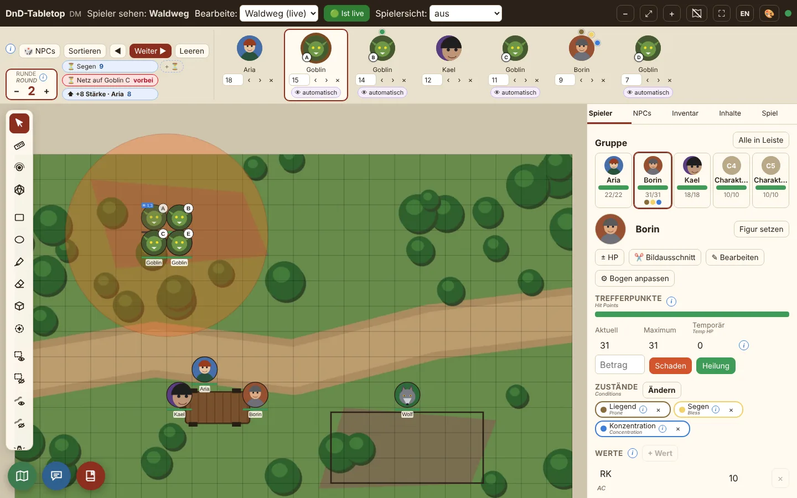

</div>

---

## Inhalt

- [Loslegen](#loslegen)
- [Die DM-Ansicht im Überblick](#die-dm-ansicht-im-überblick) · [Ohne Karte spielen](#ohne-karte-spielen)
- [Vor der Sitzung](#vor-der-sitzung): [Einladen](#1-spieler-einladen) · [Szenen und Karten](#2-szenen-und-karten) · [Bilder, Figuren und NPCs](#3-bilder-figuren-und-npcs) · [Objekte und Zeichnungen](#4-objekte-zeichnungen-und-schablonen)
- [Während des Spiels](#während-des-spiels): [Figurenmenü](#5-das-figurenmenü) · [Mehrere Figuren](#6-mehrere-figuren-auf-einmal) · [Initiative, Runden, Effekte](#7-porträtleiste-und-initiative) · [Schaden und Zustände](#8-schaden-zustände-und-0-hp) · [Charakterbogen und Attribute](#9-der-charakterbogen) · [Inventar, Waffen, Zauber](#10-inventar) · [Fog of War](#11-fog-of-war) · [Getrennte Gruppen](#12-getrennte-gruppen) · [Sicht pro Spieler](#13-sicht-pro-spieler) · [Messen](#14-entfernungen-messen) · [Würfel und Fuß ↔ Meter](#15-würfeln) · [Vorschau](#16-als-spieler-ansehen)
- [Alle zusammen](#alle-zusammen): [Tagebuch und Quests](#17-tagebuch-und-quests) · [Chat](#18-chat) · [Weltkarte](#19-weltkarte) · [Zuschauer-Bildschirm](#20-zuschauer-bildschirm)
- [Themes und Darkmode](#themes-und-darkmode) · [Deutsch und Englisch](#deutsch-und-englisch) · [Infopunkte für Einsteiger](#infopunkte-für-einsteiger)
- [Notizen, Speichern, Beenden](#notizen-speichern-beenden)
- [Was deine Spieler sehen](#was-deine-spieler-sehen)
- [Spickzettel](#spickzettel)
- [Einstellungen](#einstellungen) · [Probleme lösen](#probleme-lösen) · [Für Entwickler](#für-entwickler) · [Lizenzen](#lizenzen)

---

## Loslegen

### 1. Herunterladen

| System | Datei | Starten |
| --- | --- | --- |
| **Linux** | `DnD-Tabletop-…-x86_64.AppImage` | Rechtsklick → *Eigenschaften* → *Als Programm ausführen* erlauben, dann doppelklicken |
| **Windows** | `DnD-Tabletop-…-windows-x64.zip` | Entpacken, im Ordner **`start.bat`** doppelklicken |

Beide Dateien findest du unter **[Releases](https://github.com/Mr3Sepz/dnd_tabletop/releases)**. Node.js ist schon enthalten, du musst nichts installieren.
Den jeweils neuesten Entwicklungsstand gibt es außerdem bei jedem Lauf von [„Pakete bauen“](https://github.com/Mr3Sepz/dnd_tabletop/actions/workflows/release.yml) unter *Artifacts* (Anmeldung bei GitHub nötig).

<details>
<summary>Aus dem Quellcode starten (für Bastler)</summary>

Du brauchst [Node.js](https://nodejs.org) 18 oder neuer.

```bash
git clone https://github.com/Mr3Sepz/dnd_tabletop.git
cd dnd_tabletop
./start.sh          # Linux/macOS, unter Windows: start.bat
```
</details>

### 2. Starten

Beim Start passieren zwei Dinge:

1. **Ein schwarzes Fenster** geht auf. Das ist der eigentliche Spieltisch-Server, der im Hintergrund läuft. Darin stehen die Adressen, unter denen du und deine Spieler das Spiel erreicht:

   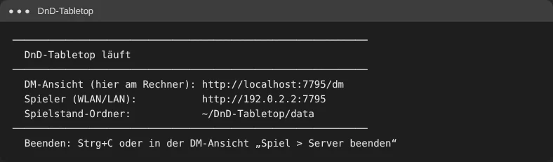

   **Lass dieses Fenster offen, solange gespielt wird.** Du kannst es verkleinern, aber wenn du es schließt, ist das Spiel aus. Gespeichert wird trotzdem.
2. **Dein Browser** öffnet die **DM-Ansicht**. Dort spielst du.

**Vollbild:** **F11** drücken oder oben auf **⛶** klicken (praktisch am Tablet).

> **Windows:** Beim ersten Start fragt die Firewall, ob Node.js ins Netzwerk darf. Erlaube das für **private Netzwerke**, sonst kommen die Spieler nicht rein.

### 3. Spieler einladen

Im Reiter **Spiel** steht ein QR-Code. Die Spieler scannen ihn mit dem Handy, wählen einen Platz und geben ihren Namen ein. Wie das genau geht, steht unter [Spieler einladen](#1-spieler-einladen).

---

## Die DM-Ansicht im Überblick


| Bereich | Was dort passiert |
| --- | --- |
| **Kopfzeile** | Welche Szene die Spieler sehen · welche Szene du gerade bearbeitest · **Live schalten** · **Spielersicht**-Vorschau · Zoom · **🌍 Weltkarte** · **🗺 Karte aus/ein** · **⛶ Vollbild** · **EN/DE** Sprache · **🎨** Theme (Darkmode, Pergament, Gruft …) · grüner Punkt = verbunden |
| **Porträtleiste** (oben) | Links **Runde** und **Effekttimer**, daneben alle Kampfteilnehmer in Initiative-Reihenfolge. Wer dran ist, hat einen roten Rahmen. Die Spieler sehen die Leiste auch |
| **Werkzeugleiste** (links auf der Karte) | 🖐 Auswählen · 📏 Messen · ▭ ◯ ✎ Zeichnen · 🧱 Objekt · 🔥 Zauberschablone · ☀ ☁ Nebel aufdecken/verdecken |
| **Karte** (Mitte) | Mausrad oder zwei Finger = Zoom, Fläche ziehen = verschieben, **Rechtsklick** oder **lange drücken** auf eine Figur = Menü |
| **Seitenleiste** (rechts) | Reiter *Spieler · NPCs · Inventar · Notizen · Szenen · Figuren · Bilder · Spiel* |
| **🎲 💬** (unten links) | Würfel mit Protokoll und Fuß-↔-Meter-Rechner · Chat |

Auf dem Tablet oder Handy klappt die Seitenleiste mit **☰** auf und zu.

### Ohne Karte spielen

Es gibt viele Momente ohne Karte: Gespräche, Reisen, Einkaufen. Oder es liegt ohnehin eine echte Karte auf dem Tisch. Dann blendest du sie mit **🗺** oben aus. Die Verwaltung nutzt danach die ganze Breite. Das geht auf **jedem Gerät**, am PC genauso wie am Handy, beim DM und bei jedem Spieler einzeln. Die App merkt es sich pro Gerät.

<table>
<tr>
<td width="70%">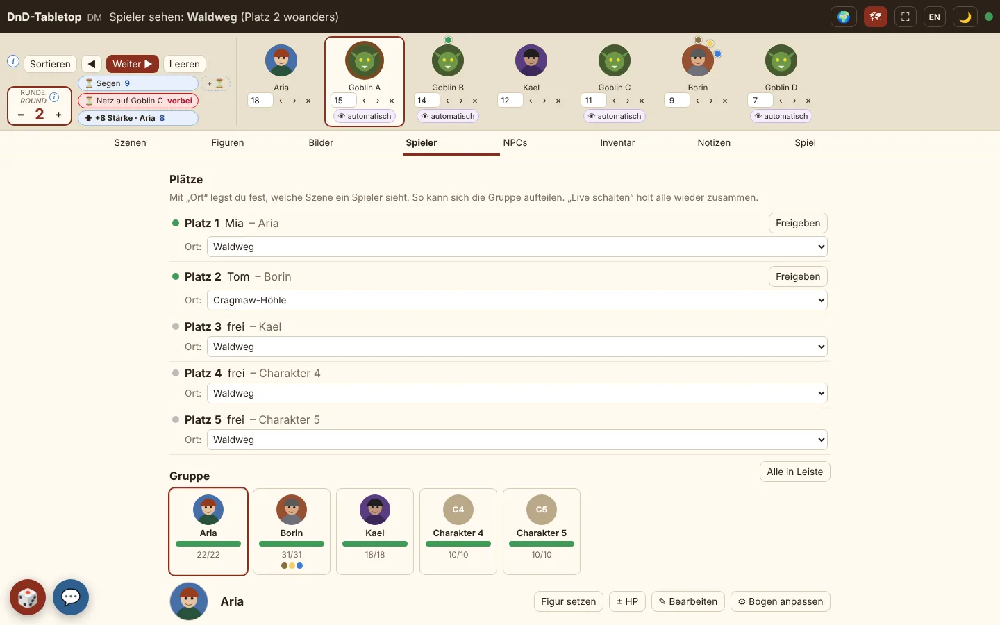</td>
<td width="30%">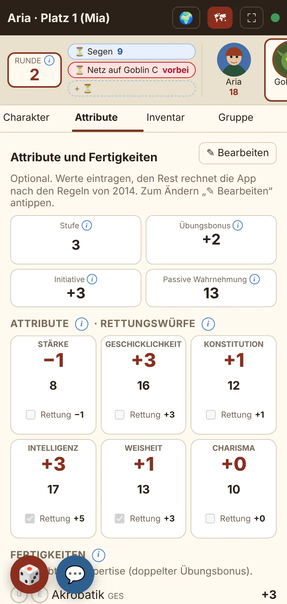</td>
</tr>
<tr><td>DM ohne Karte: Leiste, Gruppe, Bögen</td><td>Spieler am Handy ohne Karte</td></tr>
</table>

---

## Vor der Sitzung

### 1. Spieler einladen


Reiter **Spiel**:

- **QR-Code und Adresse** für alle im selben WLAN. Spielt jemand über Tailscale, erscheint zusätzlich eine zweite Adresse, die mit `100.` beginnt.
- **Raum-PIN:** Ist sie gesetzt, kommen nur Spieler rein, die sie kennen. Wer schon drin ist, bleibt drin.
- **Anzahl Spielerplätze:** Standard ist 5, möglich sind 1 bis 20. Belegte Plätze werden beim Verkleinern nie entfernt.

Fliegt jemand kurz aus dem WLAN, landet er automatisch wieder auf seinem Platz. Einen Platz freigeben kannst du im Reiter **Szenen** unter *Plätze*.

<details>
<summary>Spieler von zu Hause (Tailscale) einrichten</summary>

1. Du und jeder Mitspieler von außerhalb installiert [Tailscale](https://tailscale.com/download) (kostenlos) und meldet sich an.
2. Du lädst die Mitspieler in dein Tailscale-Netz ein (Tailscale-Adminseite → *Users* → *Invite*) oder teilst deinen Rechner mit ihnen (*Share*).
3. Die App zeigt im Reiter **Spiel** automatisch die Tailscale-Adresse (`http://100.…`) mit eigenem QR-Code.
</details>

<br clear="right">

### 2. Szenen und Karten

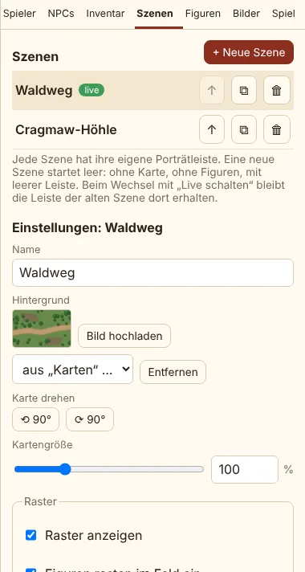

Eine **Szene** ist ein Ort mit eigener Karte, eigenen Figuren, Zeichnungen und eigenem Nebel, zum Beispiel *Waldweg* oder *Cragmaw-Höhle*.

- **+ Neue Szene**, dann **Bild hochladen**. Große Bilder werden automatisch verkleinert, damit sie bei allen schnell laden.
- **Jede Szene ist für sich:** Eine neue Szene ist **völlig leer**, ohne Karte, ohne Figuren und mit **leerer Porträtleiste**. Jede Szene hat ihre eigene Leiste mit eigenem Rundenzähler. Schaltest du eine andere Szene live, bleibt die Leiste der alten Szene dort liegen. Gehst du zurück, ist sie wieder da. Laufende Effekttimer behalten beim Wechsel ihre restlichen Runden.
- **Plätze:** Ganz unten im Reiter stehen die Spielerplätze mit ihrem *Ort* (siehe [Getrennte Gruppen](#12-getrennte-gruppen)) und *Freigeben*.
- **Raster an die Karte anpassen:** Das Raster ist sofort da. Zieh den Schieberegler **Feldgröße**, bis ein Feld genau einem Kästchen deiner Karte entspricht. Alternativ veränderst du mit **Kartengröße** die Karte unter dem Raster. Die Figuren sind immer genau ein Feld groß und passen sich automatisch an. *Versatz X/Y* schiebt das Raster ein Stück, falls es nicht ganz bündig sitzt.
- **Fuß pro Feld** (Standard 5) braucht das Lineal.
- **Figuren rasten im Feld ein:** Figuren springen beim Loslassen in die Feldmitte. Pro Szene abschaltbar.
- **Karte drehen:** **⟲ 90°** und **⟳ 90°** drehen die ganze Szene. Figuren, Zeichnungen, Nebel und Raster drehen mit, nichts verrutscht. Praktisch, wenn eine Karte im Hochformat ist oder anders herum auf dem Tisch liegen soll.
- **Nachtfilter:** Macht aus einer Tagkarte eine Nachtszene.
- **Licht malen** (nur bei Nacht): Mit **🕯️** in der Werkzeugleiste malst du über Fackeln, Lagerfeuer oder Fenster. Dort wird es für alle hell, mit warmem, orangefarbenem Feuerschein. Antippen ohne Ziehen = runder Lichtkreis. Mit **🌑 Licht radieren** wischst du über eine helle Stelle, und dort wird es wieder dunkel. Die Größe stellst du wie beim Licht unter dem Werkzeug ein. *Rückgängig* (auch fürs Radieren) und *Alle Lichter löschen* stehen unter dem Nachtfilter.

  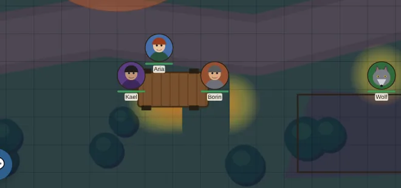
- **Notiz zur Szene:** Raumbeschreibung, Fallen, Schätze. Nur du siehst sie.

**Im Hintergrund vorbereiten:** Oben bei *Bearbeite* wählst du eine andere Szene aus. Die Spieler sehen weiter die alte, bis du **Live schalten** drückst.

<br clear="right">

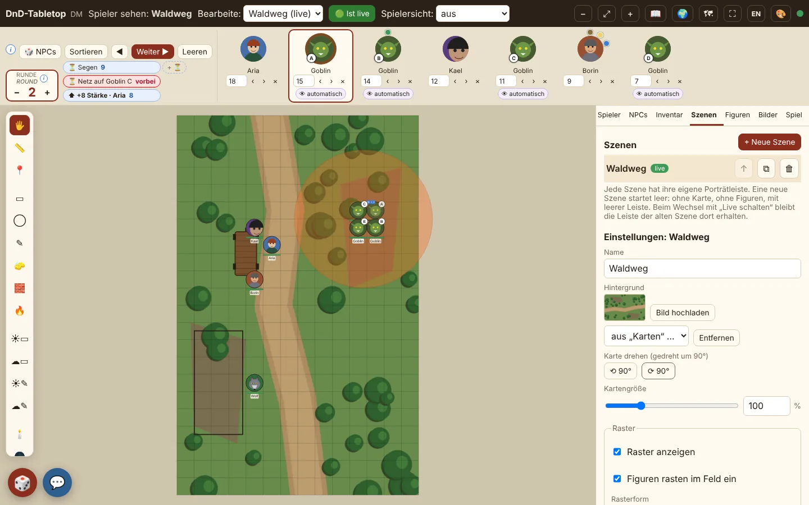

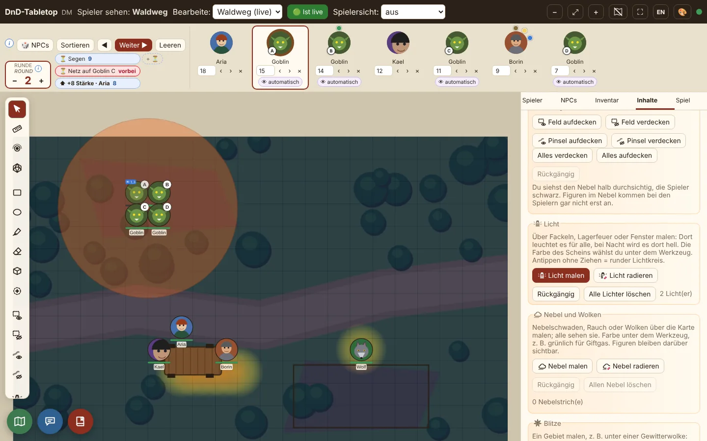

### 3. Bilder, Figuren und NPCs

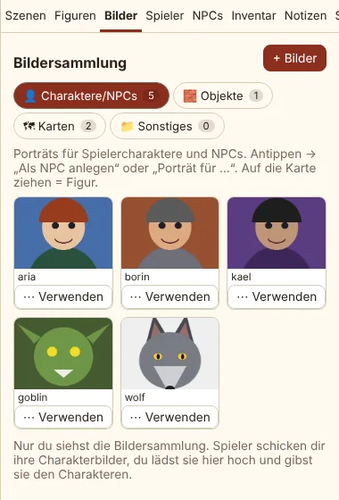

**Bildersammlung** (Reiter **Bilder**, nur für dich): **+ Bilder** oder Dateien ins Browserfenster ziehen. Danach fragt die App, in welchen **Ordner** sie gehören:

| Ordner | Wofür | Wo es auftaucht |
| --- | --- | --- |
| 👤 Charaktere/NPCs | Porträts von Helden, Monstern, Tieren | Porträt-Auswahl, Bild einer Figur |
| 🧱 Objekte | Wagen, Türen, Tische, Kisten | „Objekt setzen“ |
| 🗺 Karten | Szenenkarten, Weltkarte | Hintergrund einer Szene, Weltkarte |
| 📁 Sonstiges | alles andere | in keiner Auswahl |

Jede Auswahl zeigt nur die Bilder aus ihrem Ordner. Ein Bild antippen öffnet die passenden Möglichkeiten, z. B. **In Ordner verschieben …**. Die Spieler sehen die Sammlung nicht: Sie schicken dir ihre Charakterbilder, du lädst sie hoch und wählst bei einem Bild **🙂 Porträt für Aria**.

<br clear="right">

**Figuren** sind alles, was rund auf der Karte steht. Eine Figur kann mit einem **Spielercharakter** oder einem **NPC** verknüpft sein. Dann übernimmt sie dessen Namen, Bild und Werte. Sie kann aber auch eine reine Figur ohne Werte bleiben, z. B. eine Markierung. **NPCs haben immer Werte**, also HP und Attribute, auch ein Pferd.

**NPC und Figur bleiben verbunden:** Benennst du einen NPC um oder gibst ihm ein anderes Bild, ändern sich seine Figuren auf der Karte mit. Löschst du den NPC, verschwindet auch seine Figur. Die App sagt das vorher im Löschen-Dialog. Das Gleiche gilt für Name und Porträt von Spielercharakteren.

**Spielercharaktere** (Reiter *Spieler*): Unter *Gruppe* stehen alle Charaktere nebeneinander in einer Reihe. Gruppenkarte anklicken, Name, Porträt und HP eintragen, dann **Figur setzen**. Diese Figur darf nur der zugehörige Spieler bewegen. Du darfst immer alles.

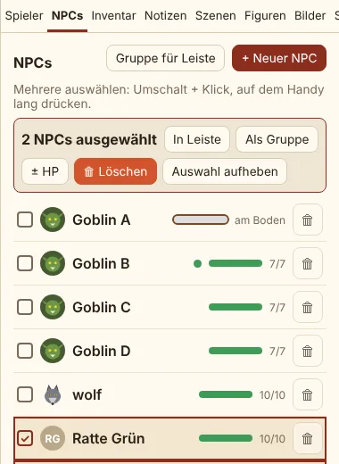

**NPC-Liste:** Jeder Eintrag hat rechts einen **🗑** zum Löschen. **Mehrere auswählen:** **Umschalt + Klick**, auf dem Handy **lang drücken**. Ist schon etwas ausgewählt, reicht ein normaler Klick. Oben erscheint dann eine Leiste mit **In Leiste**, **Als Gruppe**, **± HP**, **🗑 Löschen** und **Auswahl aufheben**.

<br clear="right">

**NPCs** (Reiter *NPCs*): **+ Neuer NPC**, Porträt und Werte eintragen, dann **Auf Karte setzen …** Schneller: ein Bild aus *Charaktere/NPCs* antippen → **📍 Als NPC auf die Karte setzen**. Ziehst du ein Bild direkt auf die Karte, wird es eine **Figur** (ohne Werte). Eine Figur ohne Bild setzt du im Reiter *Figuren* mit **Figur ohne Bild setzen**.

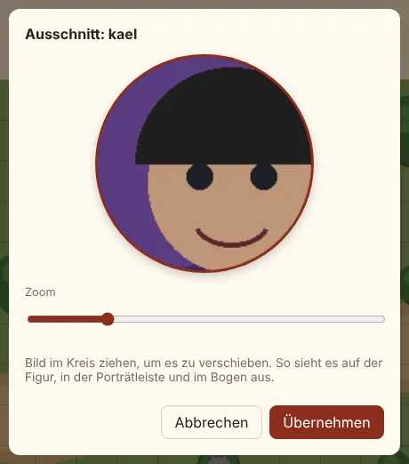

**Bildausschnitt im runden Rahmen:** Ist ein Bild nicht quadratisch, schneidet der Kreis es manchmal ungünstig ab. Im Bogen eines Charakters oder NPCs gibt es dafür **✂️ Bildausschnitt**, im Reiter *Bilder* (Ordner Charaktere/NPCs) **✂️ Ausschnitt anpassen**. Im Kreis ziehst du das Bild an die richtige Stelle, mit dem **Zoom**-Regler (oder dem Mausrad) vergrößerst du es. Der Ausschnitt gilt überall, wo das Bild rund erscheint: auf der Figur, in der Porträtleiste, im Bogen und bei den Spielern. Das Originalbild bleibt erhalten. *Ganzes Bild (zurücksetzen)* nimmt den Ausschnitt wieder weg.

<br clear="right">

**Durchsichtige PNGs:** Hat ein Bild einen durchsichtigen Hintergrund, füllt die **Hintergrundfarbe** der Figur die Lücke (Rechtsklick → *Bearbeiten …* → *Hintergrundfarbe*). Die Farbe gilt auch für das Porträt in der Leiste.

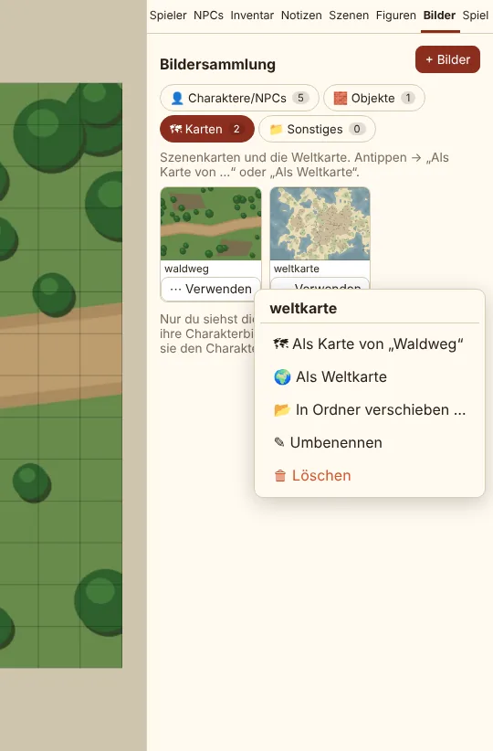

| Ordner des Bildes | Möglichkeiten beim Antippen |
| --- | --- |
| Charaktere/NPCs | 🙂 Als Figur setzen · 👹 Als NPC anlegen · 📍 Als NPC auf die Karte setzen · 🙂 Porträt für … (jeder Spielercharakter) |
| Objekte | 🧱 Als Objekt setzen · 🙂 Als Figur setzen |
| Karten | 🗺 Als Karte von „…“ · 🌍 Als Weltkarte |
| alle | 📂 In Ordner verschieben · ✎ Umbenennen · 🗑 Löschen |


Beim Setzen eines NPCs wählst du:
- **Anzahl:** 4 Goblins auf einmal. Jeder bekommt eigene HP.
- **Kennungen 1, 2, 3 … oder A, B, C …:** im Dialog auswählbar, vorgeschlagen und frei änderbar. Sie stehen als Abzeichen auf der Figur.
- **Farbmarker (Standard):** Statt Zahl oder Buchstabe wird der kleine Kreis **eingefärbt**. Das ist voreingestellt; Zahlen oder Buchstaben wählst du im Dialog. Ein einzelner NPC bekommt keinen Marker, erst wenn es mehrere gleiche gibt. Die Farben werden **jedes Mal zufällig** vergeben. So lernen die Spieler keine feste Reihenfolge wie „Rot ist immer der Erste“. Die NPCs heißen dann z. B. *Ratte Grün* und *Ratte Marine*. Unter *Bearbeiten …* kannst du die Farbe einer Figur auch von Hand setzen oder entfernen.

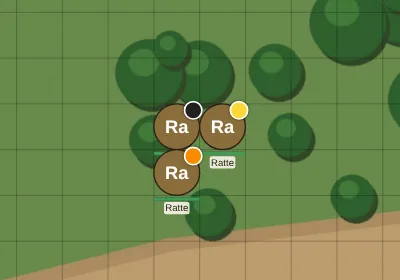
- **Versteckt setzen:** für einen Hinterhalt. Nur du siehst die Figuren, halb durchsichtig.

### 4. Objekte, Zeichnungen und Schablonen

| Werkzeug | Wofür |
| --- | --- |
| ▭ ◯ ✎ | Rechteck, Ellipse, Freihand, z. B. für Deckung, Gelände oder einen brennenden Busch. Farbe, Füllung und Strichstärke stellst du in der Leiste ein |
| 🧽 **Radierer** | Über Freihandlinien wischen. Wo du drüberfährst, verschwindet die Linie, der Rest bleibt stehen. Die Größe stellst du unter dem Werkzeug ein. Rechtecke, Ellipsen und Objekte radiert er nicht, die löschst du mit dem Mülleimer |
| 🧱 **Objekt** | Jedes **eigene Bild** aus deiner Bildersammlung als **eckiges, drehbares** Ding auf der Karte: Wagen, Tür, Tisch, Kiste, Lagerfeuer. Der Unterschied zur Figur: Figuren sind rund und für Lebewesen gedacht (mit HP, Zuständen, Initiative). Objekte sind Gegenstände, die du frei drehen und strecken kannst |
| 🔥 **Schablone** | Kreis, Kegel, Linie oder Würfel in Fuß, z. B. „Feuerball, 20 ft“ |

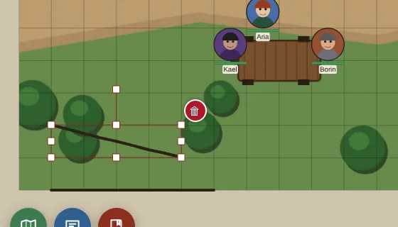

Ein Klick mit 🖐 auf eine Zeichnung oder ein Objekt zeigt Griffe zum **Verschieben, Drehen und Skalieren**. **Löschen:** den roten **🗑 oben rechts am Rahmen** antippen oder die **Entf**-Taste drücken.

<br clear="right">

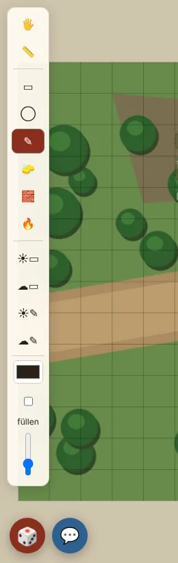

Die **Werkzeugleiste** endet über dem Würfelknopf 🎲. Passt nicht alles hinein, z. B. die Einstellungen zum Freihandzeichnen (Farbe, Füllung, Strichstärke), scrollst du in der Leiste nach unten. Darin steckt auch der **🧽 Radierer**.

<br clear="left">
 Per Rechtsklick kannst du sie **verstecken** (z. B. eine Falltür, die erst später auftaucht), **sperren**, nach vorne oder hinten legen, beschriften oder löschen.

> **Spieler haben auch 📏 Messen und 🔥 Schablonen.** So planen sie ihre Angriffe selbst: Kegel anlegen, drehen, prüfen, wen es trifft. Eigene Schablonen können sie verschieben und löschen, fremde nicht.

---

## Während des Spiels

### 5. Das Figurenmenü

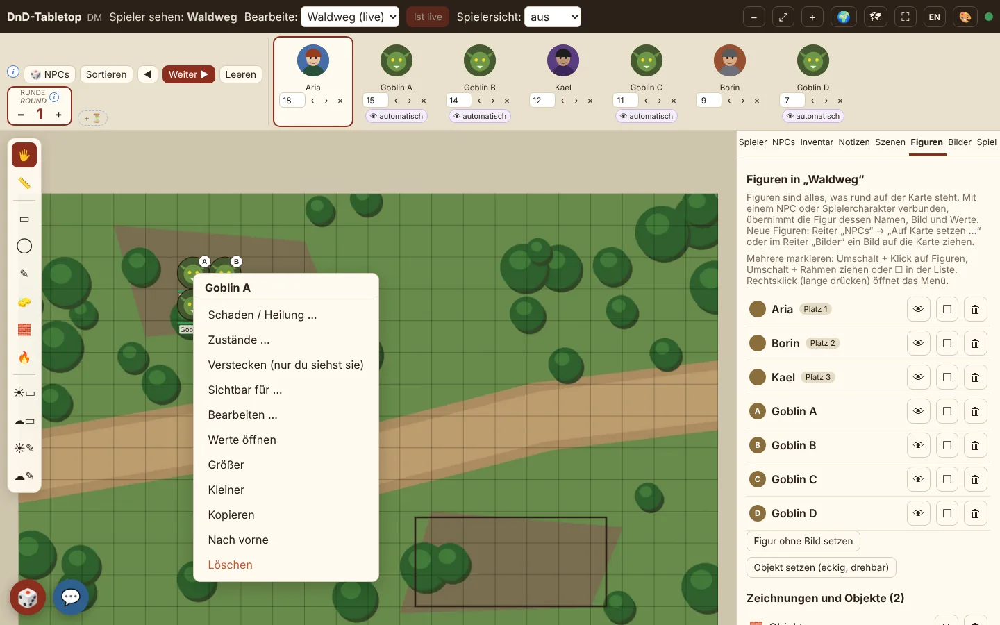

**Rechtsklick** oder **lange drücken** auf eine Figur. Das Menü gibt es mit Absicht nur so, damit nichts aus Versehen passiert.

| Eintrag | Was passiert |
| --- | --- |
| Schaden / Heilung … | Betrag eingeben → *Schaden*, *Heilung* oder *Temporäre HP*. Schaden zieht zuerst temporäre HP ab |
| Zustände … | Liegend, vergiftet, blutend, gepackt, bewusstlos, Segen, Konzentration … oder ein eigener Zustand |
| Verstecken / Aufdecken | Versteckte Figuren kommen bei den Spielern gar nicht erst an |
| Sichtbar für … | Nur bestimmte Spieler sehen die Figur ([mehr dazu](#13-sicht-pro-spieler)) |
| Bearbeiten … | Name, Kennung, Bild, Größe, verknüpfter Charakter/NPC, wer sie bewegen darf, Farbe |
| Werte öffnen | Öffnet den Bogen rechts. Das geht auch per normalem Klick auf die Figur |
| In Porträtleiste · Größer · Kleiner · Kopieren · Nach vorne · Löschen | |

### 6. Mehrere Figuren auf einmal


**Markieren**, drei Wege:
- **Umschalt gedrückt halten und Figuren einzeln anklicken.** Noch einmal klicken hebt die Markierung wieder auf.
- **Umschalt + Rahmen ziehen** auf freier Fläche. Solange Umschalt gedrückt ist, lässt sich die Karte nicht verschieben, so bleibt sie beim Ziehen des Rahmens stehen. Nach dem Loslassen verschiebt sie sich wieder wie gewohnt.
- **☐** in der Figurenliste (praktisch am Tablet).

Unten erscheint *„4 markiert · Aktionen …“*:

- **Schaden / Heilung für alle:** Feuerball, Wasserflut, Falle.
- **Zustand für alle**, **alle aufdecken / verstecken**, **Sichtbar für …**
- **Einzeln in die Porträtleiste:** Jeder Goblin bekommt einen eigenen Eintrag.
- Markierte Figuren **ziehst du gemeinsam**.

### 7. Porträtleiste und Initiative


- **In die Leiste:** im Bogen „In Leiste“, im Figurenmenü „In Porträtleiste“, für mehrere Figuren *Aktionen → Einzeln in die Porträtleiste* oder im Reiter *Spieler* „Alle in Leiste“ (nimmt nur Charaktere, die mitspielen).
- **Gleiche Gegner stehen einzeln** (Goblin A, Goblin B …) und lassen sich einzeln sortieren. Wer lieber einen Sammeleintrag „Goblins ×4“ möchte, nimmt *Aktionen → Als Gruppe in die Porträtleiste*. Das ist freiwillig.
- **Initiativwert** ins kleine Feld unter dem Porträt tippen, dann **Sortieren**. Der Höchste beginnt.
- **🎲 NPCs** würfelt die Initiative aller NPCs und NPC-Gruppen in der Leiste automatisch: **W20 + Initiativebonus** (Geschicklichkeitsmodifikator aus den Attributen, bei Standardwert 10 also ein reiner W20). Die Werte der Spieler bleiben, wie sie sind. **Sortiert wird nicht automatisch**, das machst du mit *Sortieren*, wenn alle Werte da sind.

  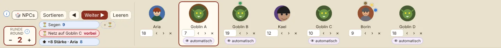
- **Reihenfolge ändern:** Porträt ziehen (Maus) oder **‹ ›** (Touch). **Weiter ▶** schaltet zum Nächsten. Ein Klick auf ein Porträt macht es zum aktuellen.
- **Doppelklick auf ein Porträt** öffnet den Bogen dieses NPCs oder Spielercharakters rechts, wo du Schaden, Heilung und Zustände einträgst. Bei einer Gruppe öffnet er den ersten NPC daraus.
- Die Knöpfe **🎲 NPCs · Sortieren · ◀ · Weiter ▶ · Leeren** stehen links **über dem Rundenzähler**. So bleibt rechts mehr Platz für die Porträts.
- **Am Porträt** steht alles über den Zustand, **die Figur auf der Karte bleibt unverändert** (nur „tot“ ändert sie):

  | Was | Anzeige am Porträt |
  | --- | --- |
  | Zustände (vergiftet, liegend, Segen …) | **farbige Punkte** rundherum um das Porträt, wie eine Perlenkette. Ein Punkt je Zustand. Platz für etwa 20; bei vielen Zuständen werden die Punkte etwas kleiner |
  | unverletzt | kein Ring |
  | angeschlagen (über halbe HP) | blassroter Ring |
  | schwer verletzt (halbe HP oder weniger) | knallroter Ring |
  | am Boden | brauner Ring |
  | tot | Porträt ausgegraut; **auf der Karte** grau mit Kreuz |

  Den HP-Ring sehen die Spieler nur bei Gegnern, ihre genauen HP nie.

**Wer sieht welchen Eintrag?** Unter jedem Gegner steht ein Knopf, z. B. **👁 automatisch**. Antippen öffnet diese Auswahl:

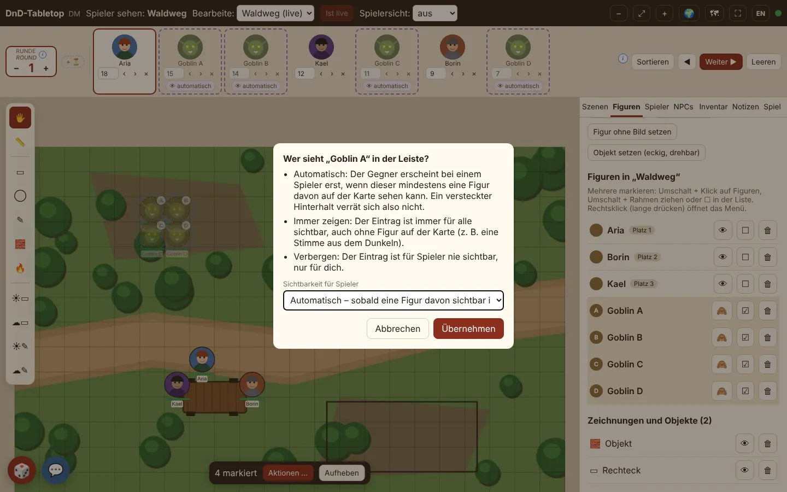

| Einstellung | Bedeutung |
| --- | --- |
| **👁 automatisch** (Standard) | Der Gegner erscheint bei einem Spieler erst, wenn dieser eine Figur davon auf der Karte sieht. **Ein versteckter Hinterhalt verrät sich also nicht durch die Leiste.** |
| **👁 immer zeigen** | Der Eintrag ist immer sichtbar, auch ohne Figur auf der Karte, z. B. für eine Stimme aus dem Dunkeln |
| **🚫 verborgen** | Nur du siehst den Eintrag |

Einträge, die gerade kein Spieler sieht, haben bei dir einen gestrichelten Rahmen.

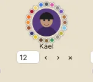

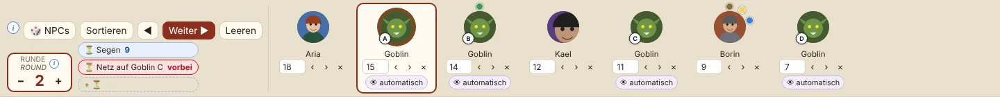

**Rundenzähler:** Ganz links unter den Knöpfen steht **Runde 2**. Wer nach dem Letzten in der Leiste auf **Weiter ▶** drückt, startet automatisch die nächste Runde. Mit **− / +** stellst du die Zahl von Hand um. **Leeren** beendet den Kampf: Runde wieder 1.

**Effekttimer:** Daneben zählen Effekte pro Runde herunter, z. B. *Segen 9*. Mit **+ ⏳** startest du einen: Name und Dauer in Runden (1 Minute = 10 Runden). Bei 0 wird er rot („vorbei“). Antippen = ändern oder entfernen. Du kannst einen Effekt **nur für dich** anlegen (z. B. „Falle scharf“). Spieler dürfen eigene Effekte starten, etwa für ihren Konzentrationszauber.

### 8. Schaden, Zustände und 0 HP

<table>
<tr>
<td width="50%"></td>
<td width="50%">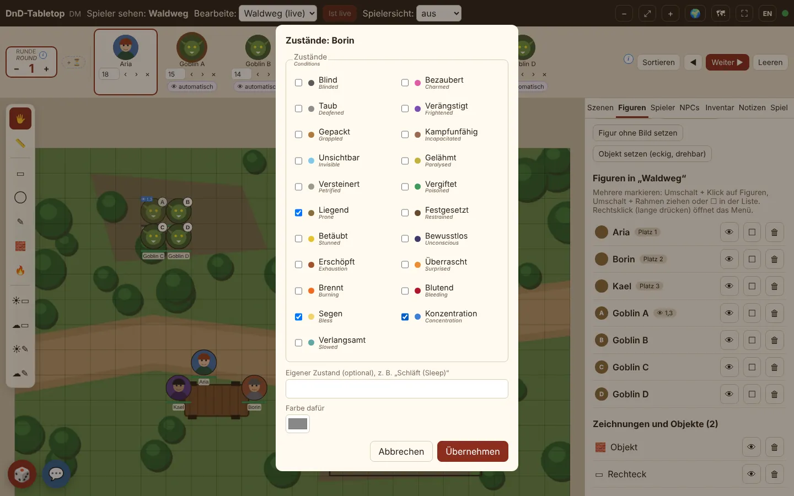</td>
</tr>
<tr>
<td><b>Schaden / Heilung</b>: über das Figurenmenü, den Knopf „± HP“ im Bogen oder für mehrere markierte Figuren.</td>
<td><b>Zustände</b>: farbige Punkte am Porträt in der Leiste, für alle sichtbar. Spieler dürfen Zustände ihres eigenen Charakters selbst setzen. Ein Klick auf einen Zustand im Bogen erklärt, was er bewirkt.</td>
</tr>
</table>

Verfügbar sind alle 5e-Zustände (blind, bezaubert, taub, verängstigt, gepackt, kampfunfähig, unsichtbar, gelähmt, versteinert, vergiftet, liegend, festgesetzt, betäubt, bewusstlos, erschöpft), dazu **Überrascht, Brennt, Blutend, Segen, Konzentration, Verlangsamt** und beliebige eigene Zustände.

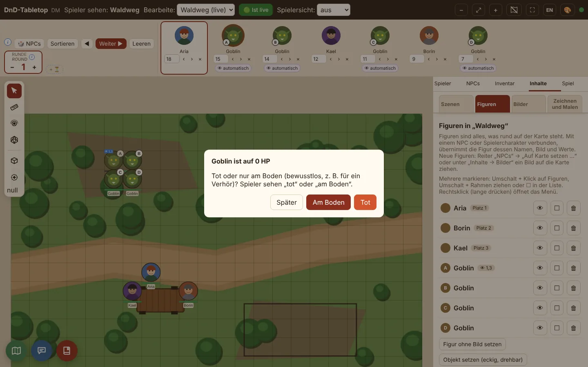

**Fällt ein NPC auf 0 HP**, fragt die App: **tot oder am Boden?** Der niedergeschlagene Goblin für das Verhör bleibt so „am Boden“ (grau). Erst „tot“ bekommt ein Kreuz. Wird er geheilt, steht er wieder. **NPCs würfeln keine Todesrettungswürfe.** Die gibt es nur bei Spielercharakteren: Bei 0 HP zeigt ihr Bogen 3 Erfolge und 3 Fehlschläge zum Abhaken.

### 9. Der Charakterbogen


Spieler und NPCs haben denselben Bogen:
- **Trefferpunkte:** aktuell, maximal, temporär; Knöpfe für Schaden und Heilung.
- **Zustände** mit Erklärung per Klick.
- **Werte** wie die RK (Rüstungsklasse), frei benennbar. Spieler sehen und ändern ihre eigene RK. Die RK von Gegnern sehen sie nie.
- **Zauberplätze als blaue Rauten** mit dem Grad (I, II, III …). Jede Raute gilt **einzeln**: Antippen = genau dieser Platz ist verbraucht und wird grau, egal in welcher Reihenfolge du tippst. Nochmal antippen = wieder frei. „Anzahl ändern“ legt fest, wie viele es pro Grad gibt. „Alle frei“ setzt nach einer langen Rast zurück.
- **Zähler:** Ki, Kampfrausch, Heiltränke …
- **Notiz** (NPC) bzw. **privates Notizbuch** (Spieler, das siehst auch du nicht).

<br clear="right">

**✎ Bearbeiten:** Damit am Handy nicht bei jedem Antippen die Tastatur aufspringt, sind die Felder im Bogen gesperrt. Erst **✎ Bearbeiten** gibt sie frei, **✓ Fertig** sperrt sie wieder. Was man im Spiel ständig braucht, geht immer: Schaden/Heilung, Rauten, Zähler-Knöpfe **− / +**, Munition, Todesrettungswürfe. Notizbücher, Gegenstände und das Tagebuch sind nie gesperrt.

**⚙ Bogen anpassen:** Ein Krieger braucht keine Zauberplätze. Hier blendest du sie aus oder ein. Außerdem hakst du **fertige Zähler** an oder ab: Inspiration, Heiltränke, Kampfrausch, Ki-Punkte, Zweiter Wind, Tatendrang, Bardische Inspiration, Göttliche Macht, Handauflegen, Zaubereipunkte, Tiergestalt, Erschöpfung, Munition. Alles kann an sein, nichts muss. Das geht auch für die Spieler am eigenen Bogen.

<table>
<tr>
<td width="62%">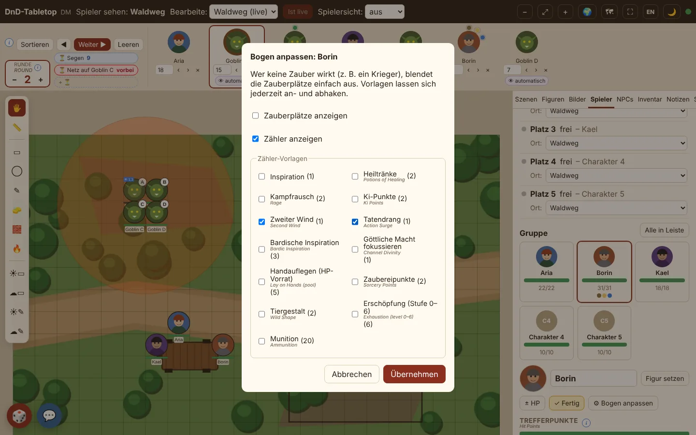</td>
<td width="38%"></td>
</tr>
<tr><td>Borin, der Krieger: keine Zauberplätze, dafür Zweiter Wind und Tatendrang</td><td>Aria, die Zauberin: in Grad I ist nur der zweite Platz verbraucht (grau). Jede Raute zählt einzeln</td></tr>
</table>

#### Attribute und Fertigkeiten (Reiter „Attribute“)

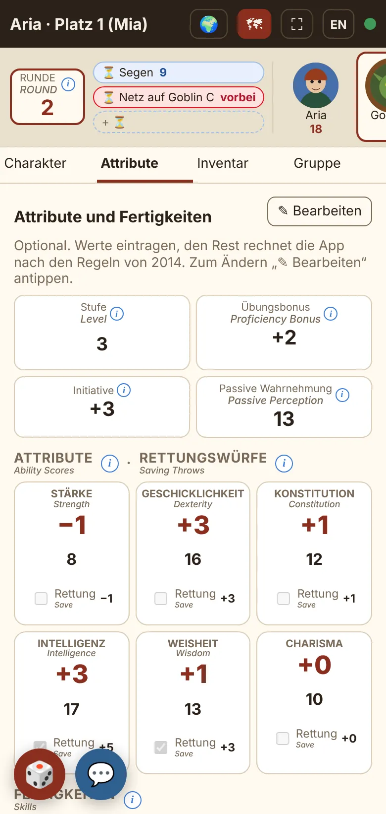

Ein **optionaler** digitaler Charakterbogen, eigener Reiter beim Spieler. Du findest ihn im Reiter *Spieler* unter dem Bogen („Attribute und Fertigkeiten“). Gerechnet wird nach den **Regeln von 2014**:

- **Stufe** trägt der Spieler ein. Der **Übungsbonus** ergibt sich daraus (+2 bis +6).
- **Sechs Attribute:** Wert eintragen, der **Modifikator** steht groß darüber, z. B. 16 → +3.
- **Rettungswürfe:** Haken = geübt, der Bonus rechnet sich selbst.
- **18 Fertigkeiten** mit zwei Punkten: **Ü** = geübt, **E** = Expertise (doppelter Übungsbonus). Die Punkte lassen sich nur nach **✎ Bearbeiten** umschalten, Antippen aus Versehen ändert also nichts.
- **Initiative** und **passive Wahrnehmung** rechnet die App mit aus.
- **Angaben:** Alter, Geschlecht, Glaube, Größe, Größenkategorie, Gewicht, Gesinnung.
- Überall **ⓘ** mit Erklärung.
- **Auch NPCs haben Attribute**, Fertigkeiten und Rettungswürfe: im Reiter *NPCs* unter dem Bogen.

<br clear="right">

#### Effekte auf Attribute (Tränke, Zauber, Flüche)

<table>
<tr>
<td width="50%">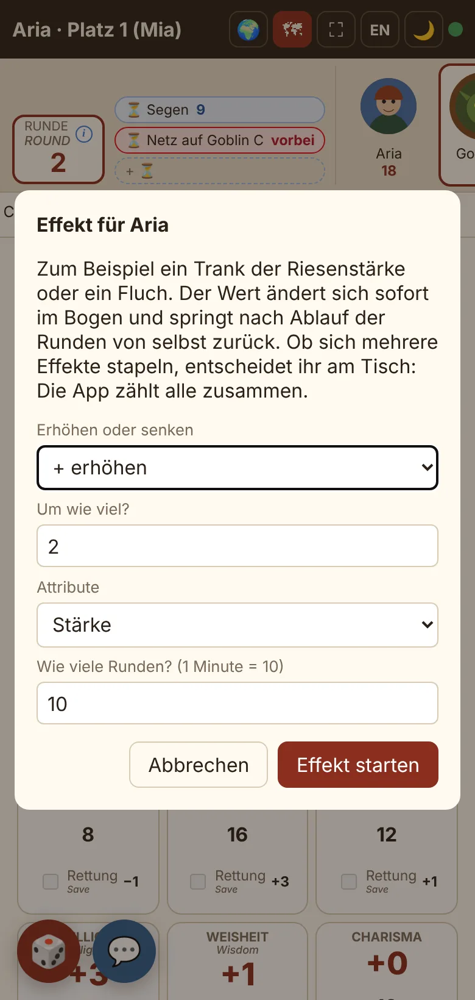</td>
<td width="50%">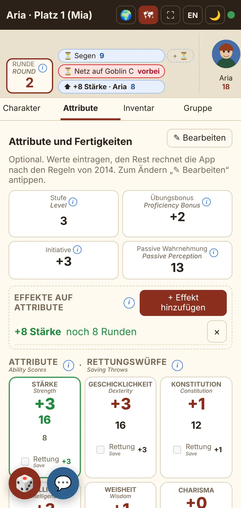</td>
</tr>
</table>

**+ Effekt hinzufügen** im Attribut-Bogen (Spieler für den eigenen Charakter, du für alle Charaktere und NPCs):

1. **Erhöhen oder senken** wählen,
2. **um wie viel** (z. B. 8),
3. welches **Attribut** (Stärke, Geschicklichkeit …),
4. **wie viele Runden** (frei eintragbar, 1 Minute = 10 Runden).

Der Wert ändert sich sofort: **grün** = erhöht, **rot** = gesenkt, der Grundwert steht klein darunter. **Alles, was davon abhängt, rechnet mit:** Modifikator, Rettungswurf, Fertigkeiten, Initiative, passive Wahrnehmung. Der Effekt steht auch als Timer in der Porträtleiste (⬆ / ⬇) und zählt mit jeder Kampfrunde herunter. **Bei 0 springt der Wert von selbst zurück.**

Mehrere Effekte gleichzeitig sind möglich, die App zählt sie zusammen. Ob sie sich laut Regeln stapeln, entscheidet ihr am Tisch. Setzt ein Trank einen festen Wert (Trank der Hügelriesenstärke: Stärke 21), trägst du den Unterschied ein, z. B. +5 bei Stärke 16. Effekte auf NPCs kannst du auch nur für dich sichtbar anlegen.

### 10. Inventar

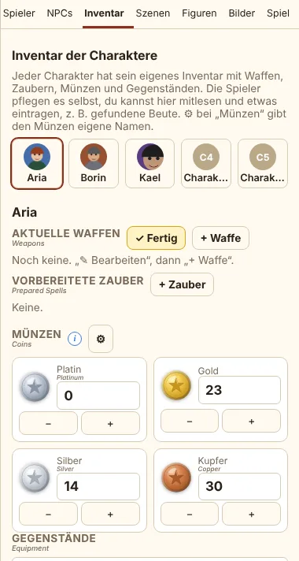

**Jeder Charakter hat sein eigenes Inventar:**
- **Aktuelle Waffen:** Name, **Angr. Bonus** (mit ⓘ: Attributsmodifikator + Übungsbonus) und Schaden/Art. Pro Waffe auf Wunsch ein **Munitionszähler** für Pfeile oder Bolzen: **−** bei jedem Schuss, **+** beim Aufsammeln.
- **Vorbereitete Zauber:** Name, Angr. Bonus, Schaden/Art, Reichweite.
- **Münzen:** Platin, Gold, Silber, Kupfer, mit **+ / −** oder direkt eintippen.
- **Gegenstände:** ein Textfeld wie ein Notizblock, ein Gegenstand pro Zeile.

**Eigene Münznamen:** Das **⚙** neben „Münzen“ (nur bei dir) gibt den Münzen für alle neue Namen, z. B. „Kronen“ statt Gold. Die Spieler sehen die Namen, ändern können sie sie nicht.

**Münzbilder:** Jede Münze hat ein Standardbild. Tippst du (als DM) auf das Bild einer Münze, kannst du ein **eigenes Bild hochladen** oder zum **Standardbild** zurück. Diese Bilder landen **nicht** in der Bildersammlung.

Die **Spieler** pflegen ihr Inventar im eigenen Reiter *Inventar*. Andere Spieler sehen es nicht. **Du** siehst im Reiter **Inventar** alle Charaktere nebeneinander in einer Reihe, antippen öffnet das Inventar. Dort kannst du etwas eintragen, z. B. gefundene Beute oder etwas, das du für später planst.

<br clear="right">

<table>
<tr>
<td width="40%">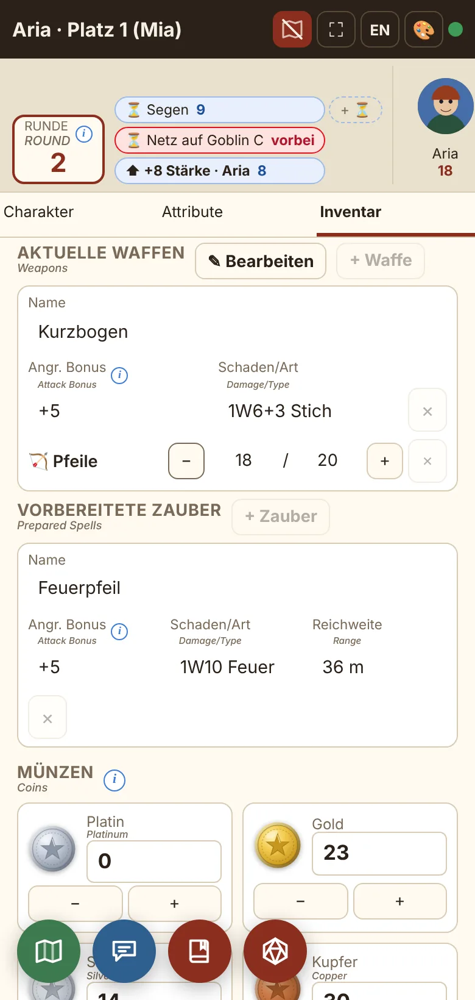</td>
<td width="60%">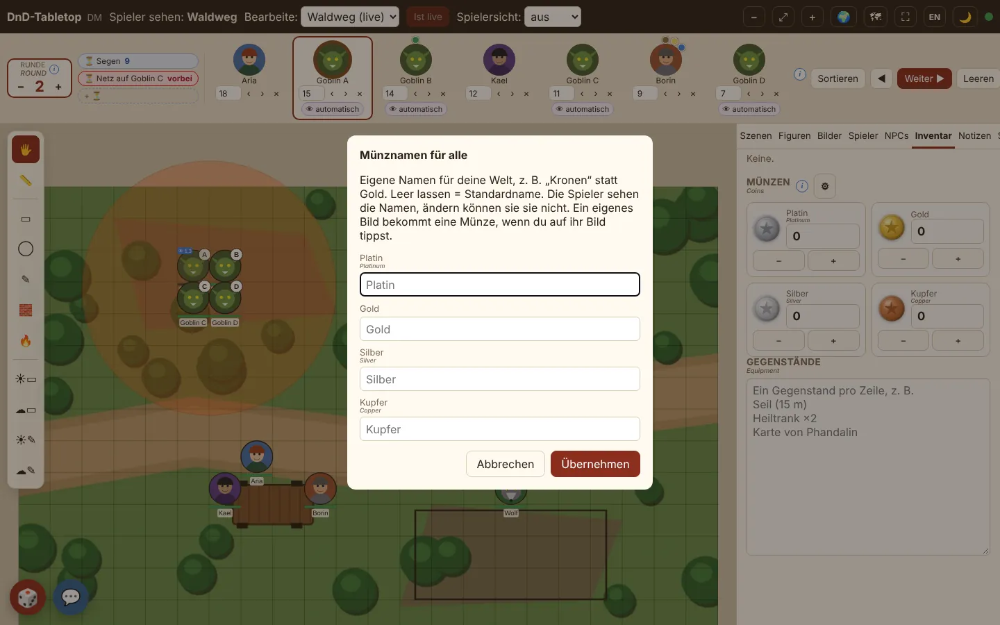</td>
</tr>
<tr><td>Am Handy: Waffe mit Pfeilzähler, Zauber, Münzen</td><td>Eigene Münznamen (⚙ beim DM)</td></tr>
</table>

### 11. Fog of War

<table>
<tr>
<td width="55%"></td>
<td width="45%"></td>
</tr>
<tr>
<td><b>Du</b> siehst den Nebel halb durchsichtig. Aufgedecktes ist hell.</td>
<td><b>Der Spieler</b> sieht nur den aufgedeckten Teil. Der Goblin im Nebel kommt bei ihm gar nicht erst an.</td>
</tr>
</table>

1. Reiter **Szenen** → **Fog of War** → *Alles verdecken*.
2. Werkzeuge links: **☀▭** Rechteck aufdecken, **☀✎** mit dem Pinsel aufdecken (Größe einstellbar), **☁▭ / ☁✎** wieder verdecken.
3. *Rückgängig* nimmt den letzten Schritt zurück. *Alles aufdecken* deckt mit einem Klick alles auf.

Eigene Figuren sieht jeder Spieler immer, auch im Nebel.

### 12. Getrennte Gruppen


Die Gruppe teilt sich auf? Im Reiter **Szenen** wählst du unter *Plätze* bei jedem Platz den **Ort**, also die Szene, die dieser Spieler sieht. Tom klettert allein in die Höhle, Mia bleibt am Waldweg.

- Die Kopfzeile zeigt dann *„Spieler sehen: Waldweg (Platz 2 woanders)“*.
- In der Szenenliste steht, wie viele Spieler gerade wo sind.
- **Live schalten** bzw. **Alle hierher** holt wieder alle in eine Szene.

<br clear="right">

### 13. Sicht pro Spieler

Nach einem Wahrnehmungswurf hat nur Mia den Goblin im Gebüsch bemerkt? Figurenmenü → **Sichtbar für …** → Platz 1 anhaken. Nur Mia sieht ihn, die anderen nicht. Bei dir trägt die Figur ein kleines blaues 👁 mit den Platznummern. Kein Haken = wieder für alle sichtbar.

**Und in der Porträtleiste?** Genauso: Bei „👁 automatisch“ erscheint der Goblin nur bei den Spielern, die seine Figur sehen. Mia hat ihn in der Leiste, die anderen nicht. Auch der [Zuschauer-Bildschirm](#20-zuschauer-bildschirm) zeigt ihn nicht.

### 14. Entfernungen messen


📏 auswählen und ziehen: Die App zeigt **Fuß und Felder** (5e-Regel: Diagonalen zählen wie gerade Felder). Beim **Ziehen einer Figur** siehst du die Strecke automatisch. **Die Spieler haben das Lineal auch.**

### 15. Würfeln


**🎲** unten links, bewusst schlicht:

Erst einstellen, dann würfeln:

1. **Vorteil** oder **Nachteil** einschalten, wenn nötig. Die Knöpfe sind **Umschalter**: Eingeschaltet sind sie rot, nochmal antippen schaltet aus. Es kann nur einer an sein.
2. **Anzahl** mit − / + und den **Würfel** wählen: W4, W6, W8, W10, W12, W20, W100. Auch der Würfel bleibt markiert, bis du einen anderen wählst.
3. Darunter steht, was gleich gewürfelt wird, z. B. *3W6* oder *2W20 · Vorteil*. Erst **🎲 Würfeln** würfelt wirklich.

Bei Vorteil und Nachteil werden immer zwei Würfel geworfen, einer zählt; die Anzahl ist dann ausgegraut. Keine Formeln, keine Boni: Was dazukommt, rechnet ihr am Tisch.

Jeder Wurf wird kurz bei allen eingeblendet und landet im Protokoll.

**Verdeckt würfeln** (Haken): Das Ergebnis siehst nur du. Echte Würfel am Tisch bleiben natürlich gleichwertig.

**Fuß ↔ Meter:** Im selben Fenster rechnet ein kleiner Rechner um, in beide Richtungen. Darunter steht der gerundete Wert der deutschen Regelbücher (5 ft = 1,5 m).

### 16. Als Spieler ansehen

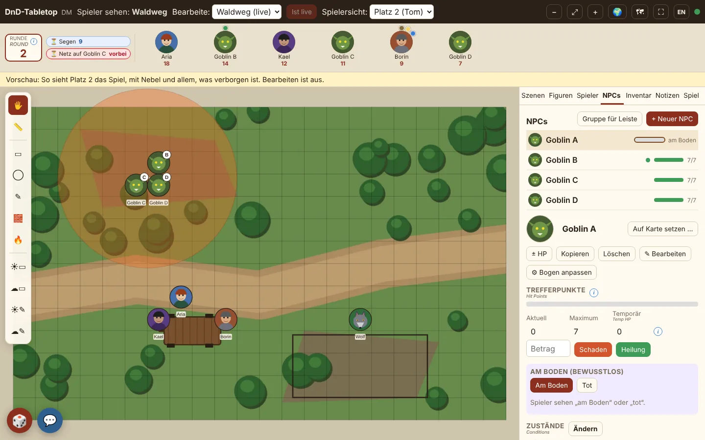

Oben bei **Spielersicht** einen Platz wählen: Du siehst **genau** das, was dieser Spieler sieht, mit Nebel, ohne Verstecktes und mit seiner Porträtleiste. Zum Beispiel, um zu prüfen, ob der Hinterhalt wirklich verborgen ist. „aus“ bringt dich zurück.

---

## Alle zusammen

### 17. Tagebuch und Quests

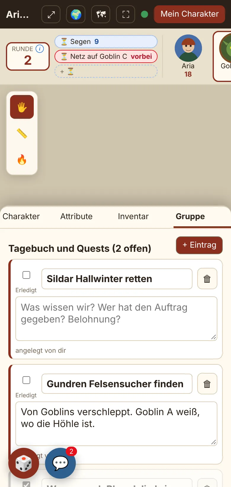

Reiter **Notizen** (bei dir) bzw. **Gruppe** (bei den Spielern):

- **+ Eintrag** legt eine neue Quest oder Notiz an. Der neueste Eintrag steht oben.
- Jeder Eintrag hat einen Titel und ein Textfeld. **Alle** dürfen alles: anlegen, schreiben, löschen.
- **Erledigt** anhaken: Der Eintrag wird **sofort** grau, durchgestrichen und rutscht hinter alle offenen. Nimmst du das Häkchen wieder weg, springt er sofort an seinen alten Platz zurück.
- Darunter stehen die **gemeinsamen Notizen** für alles andere.

<br clear="right">

### 18. Chat

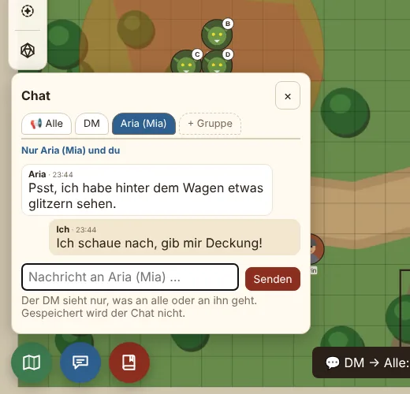

**💬** unten links neben dem Würfel. Jede Unterhaltung hat **einen eigenen Tab**, so geht nichts aus Versehen an alle:

- **📢 Alle:** alle lesen mit.
- **Ein Tab pro Person:** z. B. *Tom*. Was du dort schreibst, lesen nur Tom und du.
- **+ Gruppe:** eigene Unterhaltung mit mehreren, z. B. *Tom + Mia*.
- Über der Nachrichtenliste steht immer, wer mitliest. Ungelesenes zeigt eine rote Zahl am Tab und am 💬.
- **Was nicht an dich geht, kannst du nicht lesen.** Der Server schickt jede Nachricht nur an Absender und Empfänger.
- Der Chat wird **nicht gespeichert**, auch nicht im Spielstand. Nach einem Neustart des Servers ist er leer.

### 19. Weltkarte

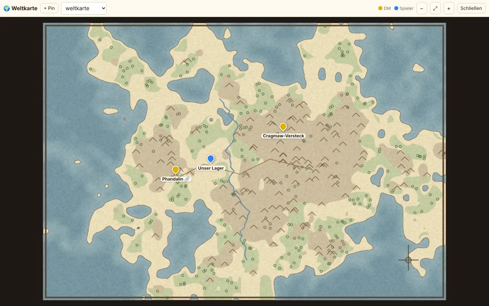

**🌍** in der Kopfzeile öffnet die Weltkarte, für dich und für alle Spieler.

- **Bild festlegen:** oben in der Auswahl oder in der Bildersammlung *⋯ Verwenden → Als Weltkarte*.
- **+ Pin**, dann auf die Karte tippen und einen Namen eingeben. **Goldgelb** = deine Pins, **blau** = Pins der Spieler. Spieler dürfen eigene Pins setzen, umbenennen und löschen, fremde nicht.
- **Pin mit Szene verknüpfen** (nur du): Beim Setzen oder per Klick auf den Pin eine Szene wählen. **Zur Szene** springt dann direkt zur Karte dieser Szene. Die Spieler sehen die Verknüpfung nicht.
- Zoomen mit Mausrad oder zwei Fingern, verschieben durch Ziehen.

### 20. Zuschauer-Bildschirm

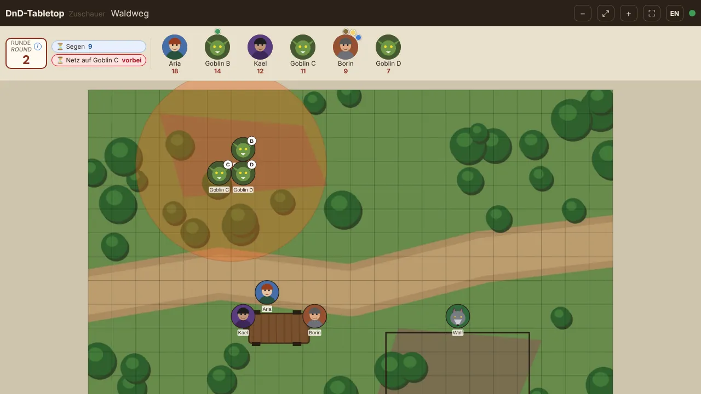

Für einen Fernseher oder zweiten Bildschirm am Tisch: **nur die Karte und die Porträtleiste**, wie eine Battle Map auf dem Tisch. Ohne Bögen, Menüs oder Notizen.

- **Öffnen:** Reiter *Spiel* → **Zuschauer-Ansicht öffnen**, oder die Adresse mit `/spectator` am Ende, z. B. `http://192.168.1.20:7777/spectator`.
- **Ja, ein zweiter Tab am selben PC geht.** Ziehe ihn auf den zweiten Bildschirm und drücke F11. Er belegt keinen Spielerplatz.
- Er zeigt die **Live-Szene** mit Nebel, so wie die Spieler sie sehen. Versteckte Figuren und Figuren, die nur einzelne Spieler sehen, erscheinen nicht.
- Von einem anderen Gerät fragt er nach der Raum-PIN, falls eine gesetzt ist.

---

## Themes und Darkmode

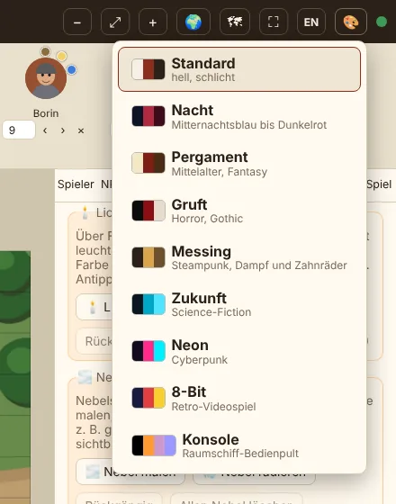

**🎨** oben in der Kopfzeile öffnet die Auswahl. Die Wahl gilt **pro Gerät**: Der DM kann im Pergament-Look spielen, ein Spieler am Handy in *Nacht*. Die Karte selbst bleibt immer unverändert.

| Theme | Passt zu | Schrift |
|---|---|---|
| **Standard** | hell und schlicht | Systemschrift |
| **Nacht** (Darkmode) | dunkle Räume, abends; Mitternachtsblau bis Dunkelrot | Systemschrift |
| **Pergament** | Mittelalter, klassische Fantasy | Cinzel, EB Garamond |
| **Gruft** | Horror, Gothic, Untote | IM Fell English |
| **Messing** | Steampunk, Erfindungen, Luftschiffe | Special Elite |
| **Zukunft** | Science-Fiction, Raumstationen | Orbitron, Exo 2 |
| **Neon** | Cyberpunk, Großstadt bei Nacht | Rajdhani |
| **8-Bit** | Retro-Videospiel, Pixel-Look | Press Start 2P, VT323 |
| **Konsole** | Raumschiff-Bedienpult: schwarze Fläche, runde Farbbalken, Großbuchstaben | Antonio |

<br clear="right">

<table>
<tr>
<td width="50%">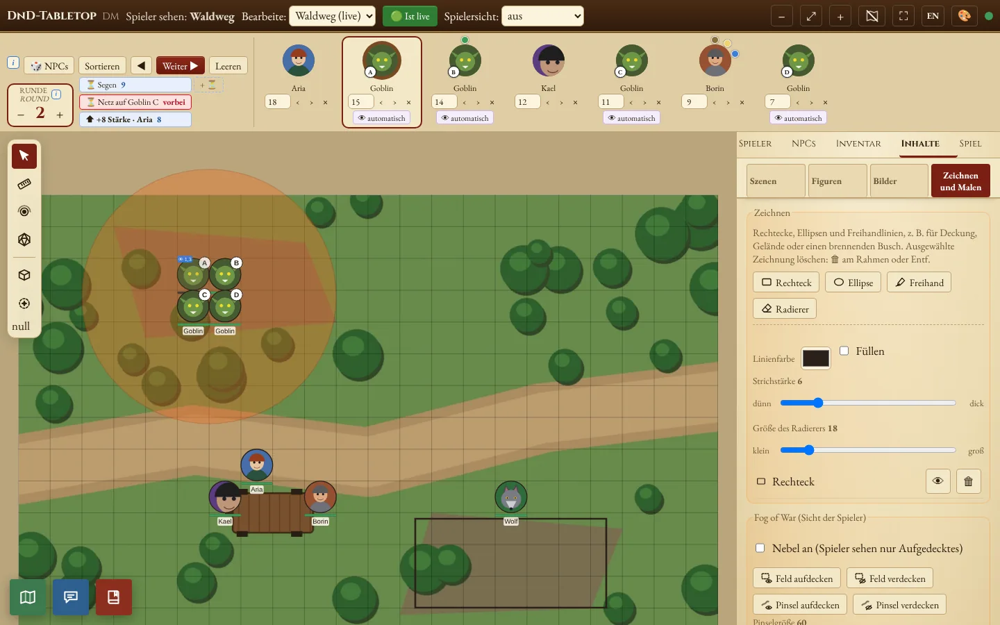<br>Pergament</td>
<td width="50%">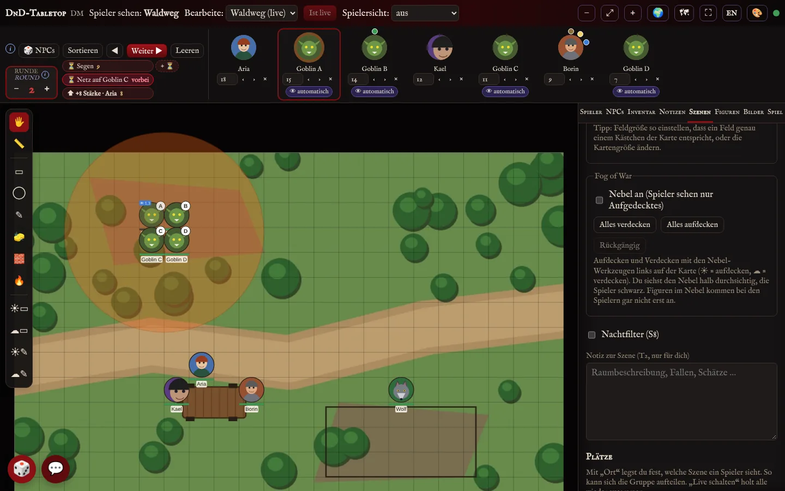<br>Gruft</td>
</tr>
<tr>
<td>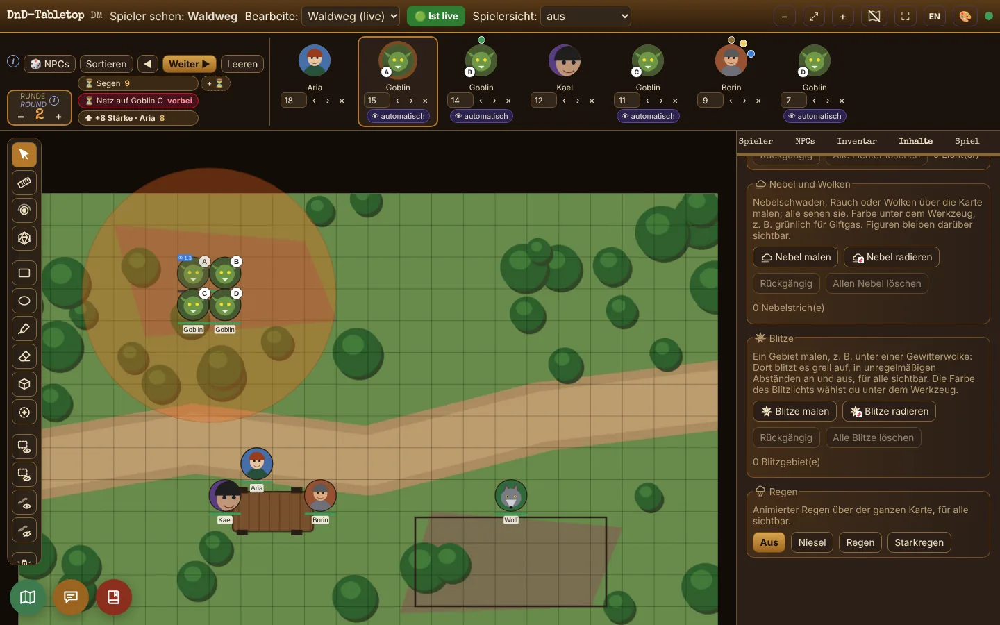<br>Messing</td>
<td>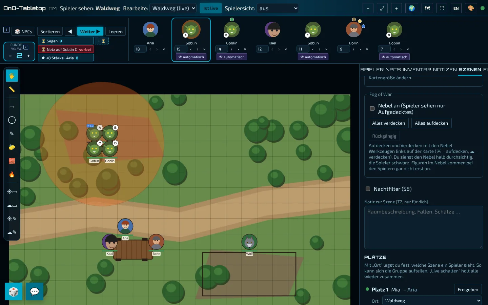<br>Zukunft</td>
</tr>
<tr>
<td>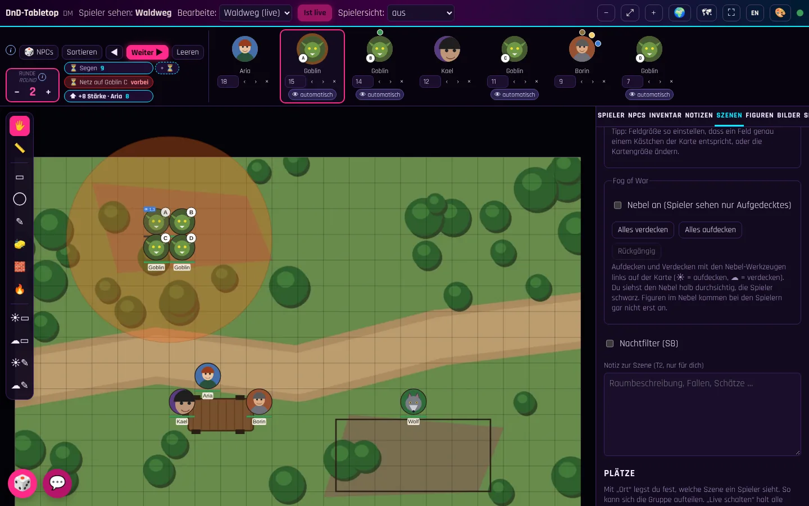<br>Neon</td>
<td>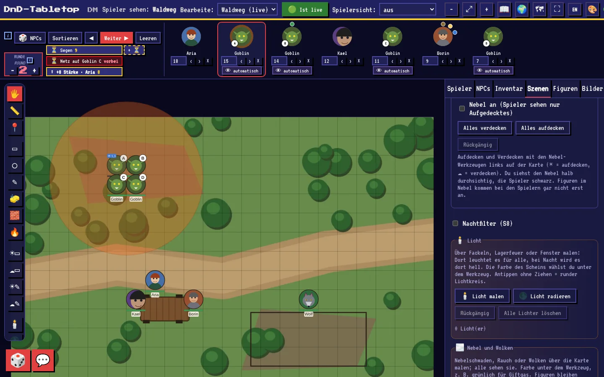<br>8-Bit</td>
</tr>
<tr>
<td>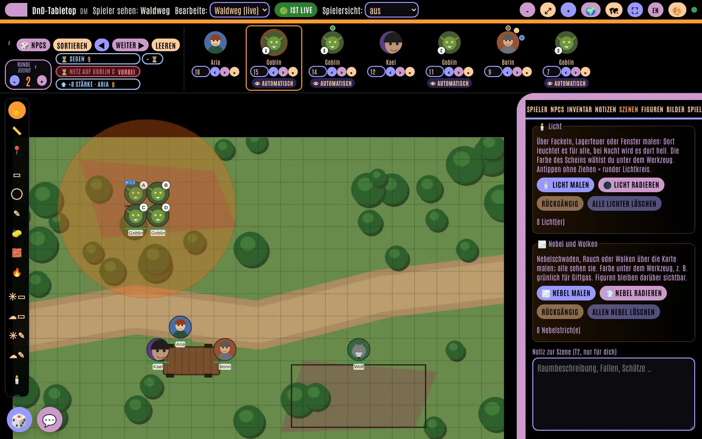<br>Konsole</td>
<td>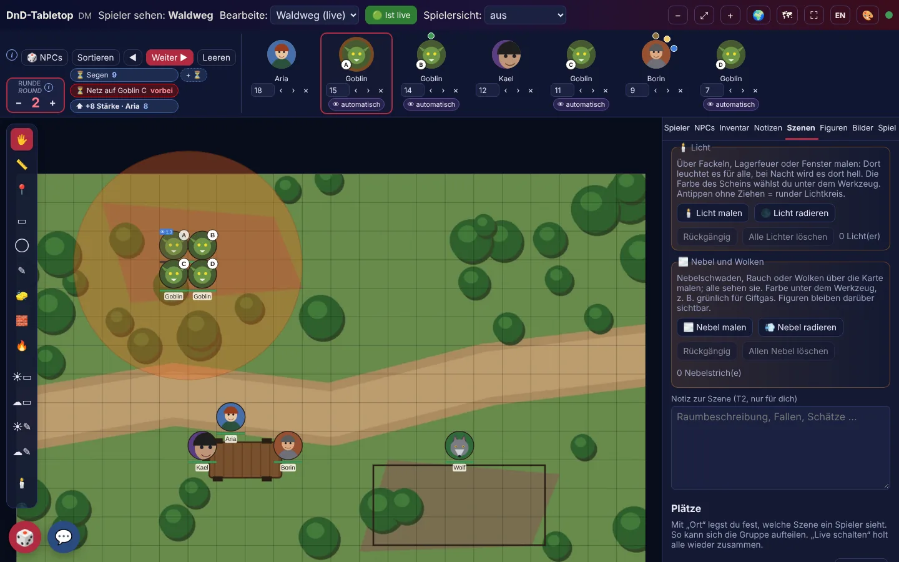<br>Nacht (Darkmode)</td>
</tr>
</table>

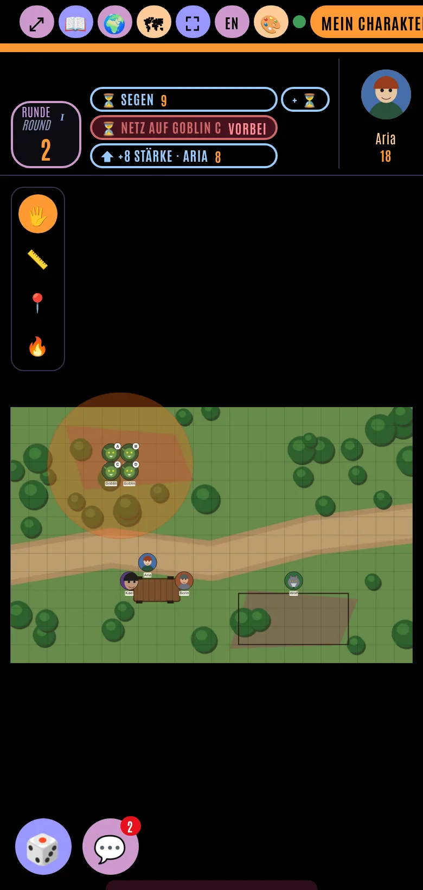
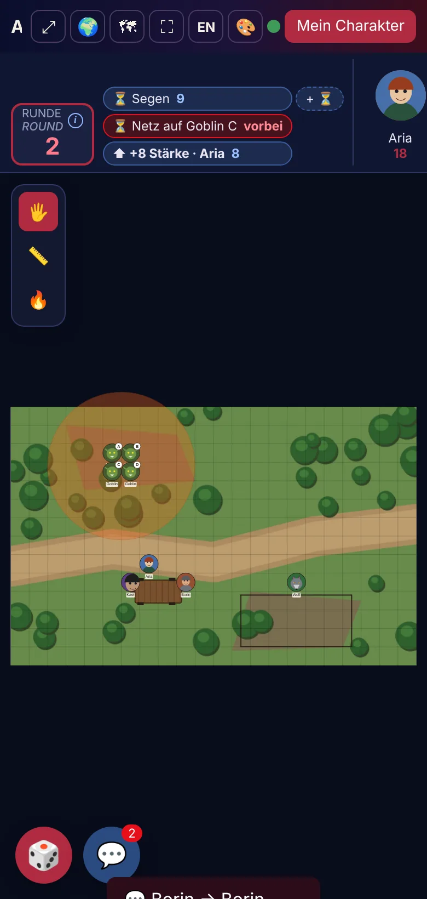

**Rechtliches:** Alle Schriften liegen in der App unter `public/fonts` und funktionieren ohne Internet. Sie stehen unter der *SIL Open Font License 1.1*, Special Elite unter der *Apache-Lizenz 2.0*. Beide erlauben das Mitliefern in Open-Source-Projekten; die Lizenztexte liegen daneben. Das Theme **Konsole** ist eine eigene Gestaltung im Stil alter Sci-Fi-Bedienpulte. Es verwendet bewusst **keine** Namen, Logos, Schriften oder Bildvorlagen aus Filmen oder Serien, also z. B. nicht den Namen „LCARS“ oder Star-Trek-Elemente.

<br clear="right">

---

## Deutsch und Englisch

<table>
<tr>
<td width="62%">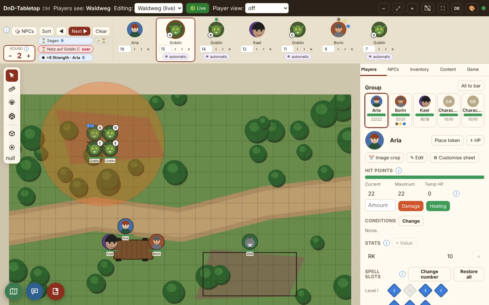</td>
<td width="38%"></td>
</tr>
<tr><td>Englische Oberfläche (UK)</td><td>Deutsch: Fachbegriffe mit dem englischen Begriff darunter</td></tr>
</table>

- **Auf Deutsch** steht bei jedem DnD-Fachbegriff der englische Begriff klein darunter: Stärke / *Strength*, Zauberplätze / *Spell Slots*, Wahrnehmung / *Perception*, Liegend / *Prone* … So findet man sich auch in englischen Regelbüchern und Videos zurecht.
- **Auf Englisch (UK)** ist die ganze Oberfläche englisch, für internationale Mitspieler, auch die Infotexte.
- **Umschalten:** **EN** bzw. **DE** oben in der Kopfzeile oder auf der Startseite. Die Wahl gilt pro Gerät. Jeder spielt in seiner Sprache, auch in derselben Runde.
- Ohne Wahl richtet sich die App nach der Sprache des Browsers.
- **Infotexte ändern** geht für jede Sprache getrennt.

---

## Infopunkte für Einsteiger

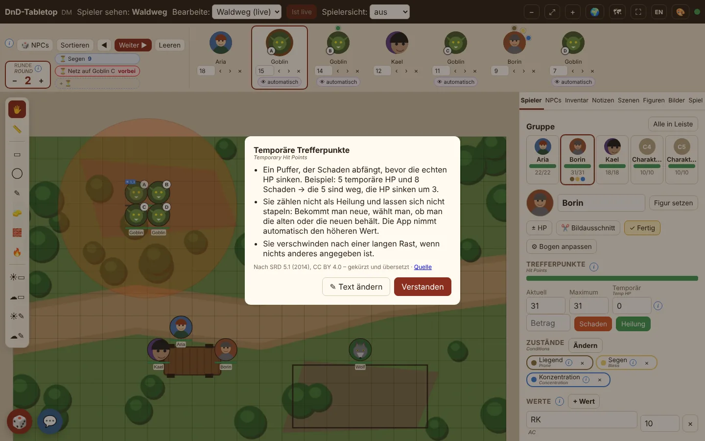

Überall, wo ein Regelbegriff steht, gibt es ein kleines blaues **ⓘ**: Trefferpunkte, temporäre HP, Todesrettungswürfe, RK, Zauberplätze, Zähler, Initiative, Vorteil/Nachteil, Münzen. Ein Klick auf einen **Zustand** im Bogen erklärt, was er bewirkt.

Die Texte sind kurze deutsche Zusammenfassungen der **5e-Regeln von 2014 (SRD 5.1)**, nicht der Regeln von 2024. Mehr dazu unter [Lizenzen](#lizenzen).

**Texte ändern:** Ist eine Übersetzung missverständlich oder taucht eine Frage immer wieder auf, klickst du im Infofenster auf **✎ Text ändern**. Eine Zeile pro Punkt. Die Änderung gilt für alle und wird im Spielstand gespeichert. **Original wiederherstellen** holt den ursprünglichen Text zurück.

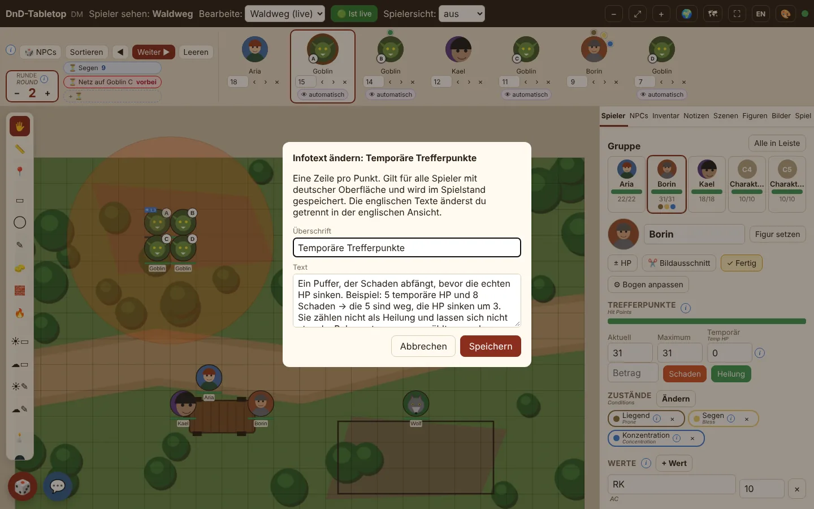

---

## Notizen, Speichern, Beenden


**Reiter Notizen**
- **[Tagebuch und Quests](#17-tagebuch-und-quests)** (sehen alle, alle schreiben mit).
- **Gemeinsame Notizen** (sehen alle, alle schreiben mit).
- **Mein Notizblock:** nur für dich.
- Private Notizbücher der Spieler siehst du nicht. Die gehören den Spielern.

Münzen und Gegenstände findest du im Reiter **[Inventar](#10-inventar)**.

**Speichern** (Reiter *Spiel*)
- **Automatisch** alle 5 Minuten und beim Beenden. Beim nächsten Start geht es genau dort weiter.
- **Spielstand herunterladen:** eine ZIP-Datei mit *allem* (Szenen, Bilder, Figuren, Nebel, Zeichnungen, Werte, Inventare, Notizen). Du kannst so oft speichern, wie du willst.
- **Spielstand laden:** stellt den Stand exakt wieder her, auch auf einem anderen Rechner.

**Beenden:** *Spiel → Server beenden* speichert und trennt alle. Alternativ schließt du das schwarze Startfenster oder drückst darin Strg+C. Ein zweiter Doppelklick auf die App öffnet die laufende Runde, statt eine neue zu starten.

<br clear="right">

---

## Was deine Spieler sehen

<table>
<tr>
<td width="30%"></td>
<td width="70%">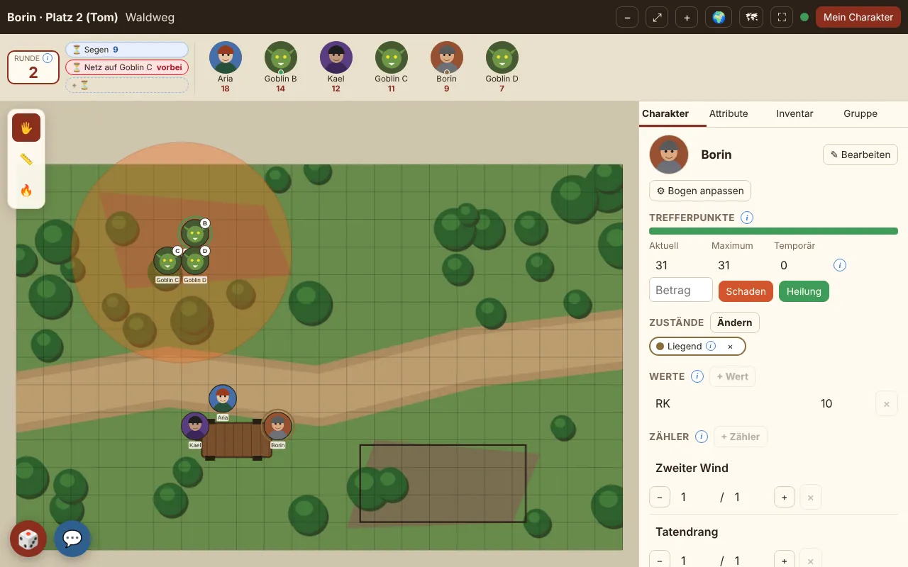</td>
</tr>
</table>

- **Ihre Szene**, ohne Verstecktes, mit Nebel. Gegner nur mit grobem Zustand.
- **Ihre eigenen Figuren** bewegen sie selbst. Andere Figuren können sie nicht bewegen.
- **Charakter:** HP, Werte, Zauberplätze, Zähler, Zustände, ein **privates Notizbuch**, das auch du nicht siehst, ⚙ *Bogen anpassen* und ✎ *Bearbeiten*.
- **Attribute:** Attribute, Rettungswürfe, Fertigkeiten, Angaben (optional).
- **Inventar:** Waffen mit Munition, vorbereitete Zauber, Münzen, Gegenstände.
- **Gruppe:** Tagebuch und Quests, gemeinsame Notizen.
- **Oben:** Runde und Effekttimer (eigene starten), 🌍 Weltkarte mit eigenen Pins.
- **Werkzeuge:** 📏 Messen, 🔥 eigene Zauberschablonen legen und drehen, 🎲 Würfeln mit Fuß-↔-Meter-Rechner, 💬 Chat, **🗺 Karte aus** (am Handy wie am PC), ⛶ Vollbild, **EN/DE** Sprache.


---

## Spickzettel

| Ich will … | So geht's |
| --- | --- |
| Karte zoomen / verschieben | Mausrad oder zwei Finger / freie Fläche ziehen · ⤢ = ganze Karte |
| Karte ausblenden | 🗺 oben (merkt sich das Gerät) |
| Vollbild | F11 oder ⛶ |
| Raster an die Karte anpassen | *Szenen* → Raster → Schieberegler *Feldgröße* (oder *Kartengröße*) |
| Bilder hochladen | *Bilder* → **+ Bilder**, oder Datei ins Fenster ziehen → Ordner wählen |
| Bild als NPC, Objekt, Karte, Weltkarte | *Bilder* → Bild antippen |
| Spielerbild zuordnen | *Bilder* → *Charaktere/NPCs* → Bild antippen → **Porträt für …** |
| Trank: +8 Stärke für 8 Runden | Bogen → *Attribute* → **+ Effekt hinzufügen** |
| Lagerfeuer bei Nacht | *Szenen* → Nachtfilter → **🕯️ Licht malen** (zu viel? **🌑 Licht radieren**) |
| NPCs würfeln Initiative | Leiste → **🎲 NPCs**, dann *Sortieren* |
| Mehrere NPCs löschen | *NPCs* → Umschalt + Klick / lang drücken → **🗑 Löschen** |
| Darkmode oder anderes Aussehen | **🎨** oben → Theme wählen |
| Felder im Bogen ändern | **✎ Bearbeiten**, danach **✓ Fertig** |
| Menü einer Figur | Rechtsklick oder lange drücken |
| Mehrere Figuren markieren | **Umschalt + einzelne Figuren anklicken** · Umschalt + Rahmen ziehen · ☐ in der Liste |
| Auswahl / Werkzeug abbrechen | `Esc` |
| Hinterhalt vorbereiten | NPC → *Auf Karte setzen …* → Anzahl + „versteckt“ |
| Goblins auftauchen lassen | markieren → *Aktionen* → *Alle aufdecken* |
| Feuerball auf mehrere | markieren → *Schaden / Heilung für alle* |
| Kampf starten | *Alle in Leiste* · Goblins markieren → *Einzeln in die Porträtleiste* · Werte eintippen · *Sortieren* · *Weiter ▶* |
| Effekt mitzählen (Segen, Netz …) | Leiste links **+ ⏳** → Name, Runden |
| Kampf beenden | **Leeren** (Runde 1, Effekte weg) |
| Höhle erkunden | Szene → *Alles verdecken* → ☀▭ / ☀✎ Stück für Stück aufdecken |
| Gruppe teilt sich | Reiter *Szenen* → *Plätze* → *Ort* pro Platz |
| Nur einer bemerkt etwas | Figurenmenü → *Sichtbar für …* |
| Krieger ohne Zauberplätze | Bogen → *⚙ Bogen anpassen* → Zauberplätze aus |
| Beute verteilen | Reiter *Inventar* → Charakter wählen → Münzen / Gegenstände |
| Geheim würfeln | 🎲 → *Verdeckt würfeln* |
| Mit Vorteil würfeln | 🎲 → **Vorteil** an · **W20** · **🎲 Würfeln** |
| Zeichnung löschen | mit 🖐 antippen → **🗑** am Rahmen oder `Entf` |
| Teil einer Freihandlinie wegradieren | Werkzeug **🧽** → drüberwischen |
| Bogen eines Gegners aus der Leiste öffnen | Porträt **doppelt** anklicken |
| 5 gleiche Gegner ohne Zahlen unterscheiden | NPC → *Auf Karte setzen …* → *Farbmarker* |
| Karte drehen | *Szenen* → **⟲ 90°** / **⟳ 90°** |
| Sprache wechseln | **EN** / **DE** oben |
| Münzbild ändern | *Inventar* → aufs Münzbild tippen |
| Fuß in Meter umrechnen | 🎲 → *Fuß ↔ Meter* |
| Einem Spieler heimlich etwas sagen | 💬 → Tab mit seinem Namen |
| Quest festhalten | *Notizen* → **+ Eintrag** |
| Ort auf der Weltkarte markieren | 🌍 → **+ Pin** |
| Karte auf dem Fernseher zeigen | *Spiel* → *Zuschauer-Ansicht öffnen* → F11 |
| Münzen umbenennen | *Inventar* → ⚙ bei „Münzen“ |
| Infotext anpassen | ⓘ → **✎ Text ändern** |
| Szene vorbereiten, ohne dass es jemand sieht | oben *Bearbeite:* andere Szene → später *Live schalten* |

---

## Einstellungen

Normalerweise musst du nichts einstellen. Wenn doch: Lege eine Datei **`config.json`** an (Vorlage: `config.example.json`). Sie gehört in den Programmordner, beim AppImage nach `~/.config/dnd-tabletop/config.json`.

| Schlüssel | Bedeutung | Standard |
| --- | --- | --- |
| `port` | Port des Servers | `7777` |
| `dmPassword` | Passwort für die DM-Ansicht. **Leer = DM-Ansicht nur am Host-Rechner.** Mit Passwort geht sie auch vom Tablet aus | leer |
| `pin` | Start-PIN für Spieler (im Spiel änderbar) | leer |
| `seats` | Spielerplätze für neue Spielstände (im Spiel änderbar, 1–20) | `5` |
| `autosaveMinutes` | Autosave-Intervall | `5` |
| `dataDir` | Ordner für Spielstand und Bilder | `data` bzw. `~/.local/share/dnd-tabletop` |
| `openBrowser` | DM-Ansicht beim Start öffnen | `true` |
| `language` | `de` oder `en`: Sprache für Standardnamen neuer Spielstände („Erste Szene“ / „First scene“). Die Oberfläche wählt jeder selbst | Systemsprache |

Umgebungsvariablen gehen auch: `PORT`, `DND_DM_PASSWORD`, `DND_PIN`, `DND_SEATS`, `DND_DATA_DIR`, `DND_LANG`, `DND_NO_BROWSER=1`.

---

## Probleme lösen

<details>
<summary><b>Spieler kommen nicht rein</b></summary>

- Ist das Handy im **selben WLAN** (nicht im Gäste-WLAN)?
- Windows: Hat die Firewall Node.js für **private Netzwerke** erlaubt? Sonst: *Windows-Sicherheit → Firewall → App durch die Firewall zulassen → Node.js*.
- Stimmt die **PIN**? Im Reiter *Spiel* kannst du sie ändern oder leeren.
- Läuft das schwarze Startfenster noch?
</details>

<details>
<summary><b>„Platz ist schon belegt“</b></summary>

Reiter *Szenen* → *Plätze* → bei dem Platz **Freigeben**. Danach kann sich der Spieler neu anmelden.
</details>

<details>
<summary><b>AppImage startet nicht (Linux)</b></summary>

- Ausführbar machen: `chmod +x DnD-Tabletop-*.AppImage`
- Fehlt **FUSE**, hilft unter Ubuntu `sudo apt install libfuse2` oder der Start mit `./DnD-Tabletop-*.AppImage --appimage-extract-and-run`.
</details>

<details>
<summary><b>„Port ist von einem anderen Programm belegt“</b></summary>

In der `config.json` einen anderen `port` eintragen, z. B. `7778`.
</details>

<details>
<summary><b>DM-Ansicht vom Tablet aus nutzen</b></summary>

In der `config.json` ein `dmPassword` setzen. Ohne Passwort ist die DM-Ansicht aus Sicherheitsgründen nur am Rechner erreichbar, auf dem die App läuft.
</details>

---

## Für Entwickler

```bash
npm install
npm run dev                       # Server mit automatischem Neustart
npm test                          # Server-Tests (Linux und Windows in GitHub Actions)
python3 test/browser_tour.py      # Browser-Rundgang, erzeugt die Bilder in docs/img
bash scripts/build-appimage.sh    # Linux-AppImage
bash scripts/build-windows.sh     # portable Windows-ZIP
```

- [docs/ARCHITEKTUR.md](docs/ARCHITEKTUR.md): wie es funktioniert und wo was liegt
- [docs/FEATURES.md](docs/FEATURES.md): Status aller Funktionen

---

## Lizenzen

- **Programm:** MIT (siehe [LICENSE](LICENSE)). Die Testgrafiken in `test/art` sind für dieses Projekt erstellt.
- **Regeltexte in den Infopunkten** (`shared/rules-help.json` deutsch, `shared/rules-help.en.json` englisch): gekürzte Bearbeitungen. *This work includes material taken from the System Reference Document 5.1 (“SRD 5.1”) by Wizards of the Coast LLC and available at https://dnd.wizards.com/resources/systems-reference-document. The SRD 5.1 is licensed under the Creative Commons Attribution 4.0 International License available at https://creativecommons.org/licenses/by/4.0/legalcode.* Die Texte wurden übersetzt, gekürzt und um Hinweise zur Bedienung der App ergänzt. Die Zustände „Brennt“ und „Blutend“ stammen nicht aus dem SRD.
- Kompatibel mit der fünften Edition („5E compatible“).
